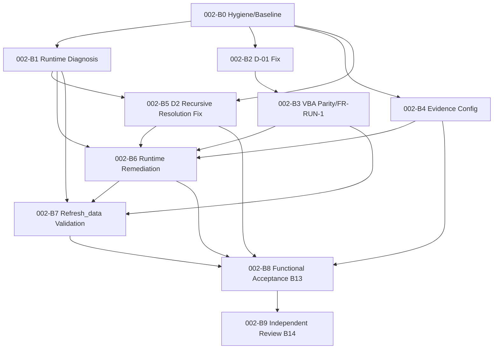

# Execution plan: treport (001_treport, rev.5) — updated baseline

- **Plan ID:** 002-treport-execution-plan
- **Supersedes (planning baseline for remaining work):** `.ai/plans/001-treport-execution-plan.md` (rev. 5, 2026-11-14) — retained as historical lineage; this document is the current execution baseline.
- **Based on:** `.ai/problems/001_treport_spec.md` **rev. 5** (2026-11-14, D1–D18, FR-CFG/FILE/REF/FLT/RPT/NAME/RUN, §13), `.ai/reports/001-treport-acceptance-report.md` (2026-11-15, FAIL), `.ai/reports/002-treport-implementation-status-and-next-steps.md` (2026-11-15), and auditor `{code_context}` evidence supplied with this planning request.
- **Planning date:** 2026-11-15
- **Planning intent:** dependency-safe, minimal-scope, incremental rollout to a functionally verified rev.5 VBA solution. This plan reflects current implementation reality (substantial exported VBA logic exists but contains critical defects, parity gaps, and unverified runtime behavior) and prioritizes unblocking: runtime diagnosis/stabilization, D-01 fix, workbook/VBA parity & FR-RUN-1 reconciliation, runnable-config handling for evidence, runtime validation (OQ-T1–T4, B13 scenarios), file-resolution alignment/decision, and hygiene. **No final implementation approach is chosen where technical/runtime uncertainty remains** (PQ sync/persist mechanics, pivot object/presented-range/copy mechanics, runtime-vs-export parity, and `report_wclip` Year vs grouped `Years` runtime semantics).
- **Execution posture:** proceed with evidence-driven VBA-compliant changes in `treport.xlsm` working copies and required tracked VBA exports/config/docs only as justified. Auxiliary development tools (Python/PowerShell/BAT/COM inspection) may be used for diagnosis, inspection, extraction/analysis, comparison, and test-data preparation but **must not become runtime dependencies** of the final user-facing solution. Large Excel workbooks/generated reports remain local/gitignored (backup/working-copy workflow); do not commit them.
- **Change control (this task):** this is a planning/documentation deliverable. **No source code, workbook binary, data file, or existing audit-phase report file is modified by this plan creation.** Existing audit phase files `.ai/reports/001-treport-acceptance-report.md` and `.ai/reports/002-treport-implementation-status-and-next-steps.md` are read-only inputs.

## Scope and guardrails (rev.5, mandatory)

- **In scope (remaining):** stabilize and diagnose runtime execution; remediate critical/high defects and spec-conformance gaps evidenced to date (D-01, workbook/VBA parity & FR-RUN-1 reconciliation, file-resolution ambiguity/scope decision per FR-FILE-1/D2, runnable acceptance-config handling for evidence without weakening D14/Trim); complete runtime validation/acceptance (OQ-T1–T4, D18/B13 scenarios) for `Refresh_data` and `Create_report`; reconcile tracked maintainability exports with reviewed workbook VBA; workspace hygiene required for safe, attributable execution.
- **Runtime boundary (mandatory):** end user runs the final solution in Excel with VBA only (no Python/PowerShell/BAT/external runtime). Auxiliary tools/scripts are non-runtime aids only.
- **Out of scope (current):** `group_rows` color-band grouping (D13, deferred/no-op), golden expected-output workbook (D18), non-Excel runtimes/schedulers/UI redesign, source data/upstream PQ/model changes, committing large `data/theiss` files/results, invented requirements/mappings, broad rewrites, speculative redesign.
- **Local artifact policy:** `data/theiss/*` and working `treport.xlsm` copies are gitignored/local; perform workbook/data-affecting actions on backed-up working copies, preserve originals, store evidence locally (paths/hashes/snapshots/outputs as practical).
- **Non-runtime artifacts:** `mko_treport/src/vbs/export/*` and `mko_treport/src/vbs/vbaProject.bin` are maintainability aids (runtime-vs-export parity unverified, OQ-T4). `.ai/tmp` harnesses are auxiliary/non-runtime and must not be referenced by VBA or required by end users.
- **Safety constraints:** never use line numbers — use semantic anchors (modules/procedures/functions/ListObjects/sheet/control names, config keys). Never merge conflicting recommendations into one task. Never split work except where it improves dependency isolation, risk containment, parallel execution, or independent reviewability. Prefer safety constraints over speed.

## Current implementation reality (evidence-based snapshot)

| Area | Observed state | Implication for plan |
|---|---|---|
| Exported VBA logic (`mko_treport/src/vbs/export/*.bas`, `vbaProject.bin`) | Substantial rev.5-oriented implementation exists: config/Trim/validation (`modTreportConfig`), deterministic file resolve/open-close (`modTreportFiles`; later regressed to non-recursive in `ea6409eb`, must be restored per D2), filters DSL/dependency-aware min/max/year handling and generalized `articleLevel4Name_clean` multi-value report logic (`modTreportFilters`), pivot helpers/placement/selection (`modTreportPivot`), refresh scaffold with sync attempts+timeout (`modTreportRefresh`), presented-range copy/formatting (`modTreportExtract`), output/naming/placeholders/idempotency helpers (`modTreportOutput`), state restore (`modTreportState`), real `Refresh_data`/`Create_report` orchestration (`modTreportRun`). `group_rows` treated as no-op. | Do not assume from-scratch B4–B12; focus on defect remediation, parity, runtime proof, and spec conformance. |
| Baseline plan B4–B12 statuses | Stale vs implemented exports per auditor/report evidence. | Re-baseline as implemented-in-exports / unverified-in-runtime with targeted fixes. |
| B1 / FR-RUN-1 (UI) | Static workbook UI evidence shows two `run` controls `Refresh_data`/`Create_report` bound to `modTreportRun.*` and no `RunXlconcat` binding in inspected UI XML/VML; compile/click/runtime not verified. | FR-RUN-1 is **not accepted** until workbook VBA parity, compile, and runtime invocation are proven. |
| Workbook/VBA parity (OQ-T4/R7) | Embedded `xl/vbaProject.bin` in current workbook copies contains legacy strings (`RunXlconcat`, `xlconcat_macro`) and unexpected module-name strings (`modTreportExtractL`, `modTreportOutput2`, `modTreportStatea`, `modTreportStateJ`) not present in exports; export `xlconcat_macro.bas` deleted in working tree but exists in HEAD; standalone `src/vbs/vbaProject.bin` differs and contains legacy markers. Compile/runtime equivalence unproven. | Treat workbook project as untrusted for delivery until rebuilt/synchronized/compiled from reviewed source. |
| Runtime execution | End-to-end runtime unverified. Latest probe inconclusive/possibly hung (`settings!Z10=RUNNING`, no outputs, lingering Excel PIDs, `.ai/tmp` locks/artifacts). `Refresh_data` not executed end-to-end. | Diagnosis/stabilization and bounded, auditable harnesses are prerequisites to credible B13 evidence. |
| D-01 (Critical) | `modTreportRun.ProcessDataFile` tracks sheet-name collisions in one dictionary across all report workbooks per data-file pass while sheet names derive from the same `data_files.report_sheet` template в†’ false fail-fast 2612 on second+ report, blocks normal multi-report FR-RPT-1/2, D3, D14, B11. | First mandatory code fix before successful multi-report generation. |
| D-04 / FR-FILE-1,D2 | `modTreportFiles` was changed (commit `ea6409eb`, 2026-11-16) to **non-recursive, root-only** search, causing regression when `data_file` workbooks reside in subfolders (e.g. `monthly/`, `weekly/`, `base/`). This conflicts with updated D2/FR-FILE requiring deterministic **recursive** search within the `input_path` subtree and unambiguous single-candidate resolution (fail-fast on 0 or >1 total candidates across searched scope and allowed extensions `.xlsx,.xlsm,.xlsb`, no precedence tie-breaker). | **Decision (2026-11-16):** restore/fix to recursive subtree search per D2 with deterministic traversal/collection and clear diagnostics (searched path incl. subfolders, cause, candidate paths when ambiguous). |
| Runnable config for evidence | Canonical config contains `DOLGIT` vs `DOLGIT ` (Trim-correct 2611 fail-fast by D14) blocking successful-run evidence. | Must be handled by evidence-only config adjustment on working/test copies (or documented negative case), never by weakening D14. |
| V-007/V-018/OQ-T1/R1/R3 | Config aligned to `Year` for all files (user-updated). Base `Year` present in all sources; `report_wclip` also has grouped `Years`. Runtime semantics/selection/resolution in `report_wclip` unverified. | Excel-runtime validation gate; no guessed mapping. |
| V-008/D9 (generalized) | `articleLevel4Name_clean` multi-value: if any configured token matches, apply matched subset; if none match for that report context, warn and skip that report (continue other reports, do not fail whole run). Historical example: `ЗУБНАЯ ПАСТА ДЛЯ ДЕТЕЙ` absent while `ЗУБНАЯ ПАСТА` present. Static/runtime behavior per implementation state requires verification. | Must be covered in B13 scenarios per current generalized rule. |
| OQ-T2 | PQ sync completion + persisted save/close behavior unverified; environment-specific connection paths possible. | Validate on target Excel with controlled writable runs. |
| OQ-T3/R5 | Presented-range bounds and values/formats/widths/row-heights fidelity (page-filter exclusion, labels/totals as shown) unverified; fallback/layout-dependent. | Validate against actual source presented state per D18. |
| Workspace hygiene | Dirty tree: modified `.ai/plans/001-treport-execution-plan.md` and tracked workbook copies, deleted `mko_treport/src/__init__.py` and `mko_treport/src/vbs/export/xlconcat_macro.bas`, untracked `.ai/problems/P01.md`, `.ai/reports/*`, `.ai/tasks/templates/*`, `.ai/tmp` probe artifacts/locks. | Plan hygiene/remediation steps; do not perform git actions that rewrite history. |

## Agent role key and high-risk rule

- **Auditor:** deeper code/architecture/artifact/workbook investigation where complexity or uncertainty exists; evidence collection and parity/runtime diagnosis.
- **Researcher:** modern/best-practice and platform behavior (Excel/VBA/PQ/pivot/cache, synchronous refresh, presented-range extraction, VBA project/component hygiene) and viable alternatives/implications.
- **Planner:** sequencing, dependency/risk containment, detailed pre-implementation design, and verification structure.
- **Validator:** independent plan/review/verification gate for correctness and risk.
- **Implementor:** execute a single, bounded, implementor-ready task (one implementor at a time for blocks leading to code changes), including required local validation/tests proportionate to risk.
- **High-risk rule:** every block marked **High risk** requires involvement of **Auditor, Researcher, Planner, Validator** as appropriate (and Implementor only when an implementor-ready change task is authorized/scheduled).

## R1–R9 traceability (rev.5)

| Risk | Summary | Planned handling / blocks |
|---|---|---|
| R1 | Pivot topology, presented ranges, year field runtime behavior (`Year` in all files; `report_wclip` also grouped `Years`) | B1,B5,B6,B7,B8,B9 (evidence-based/config-aligned to `Year`, no guessed mapping, Excel runtime validation) |
| R2 | PQ refresh completeness/timing and connection portability | B1,B5,B8 (bounded diagnosis + OQ-T2 validation in target Excel, record env/prereqs) |
| R3 | `min`/`max` member semantics in resolved context (incl. grouped `Years`) | B1,B6,B8 (log/resolve per file, runtime scenarios) |
| R4 | `group_rows` conflicting historically — **deferred/no-op** | All blocks: preserve no-op/non-blocking behavior (D13) |
| R5 | Copy fidelity vs actual presented source state (no golden) | B1,B7,B8 (functional/source comparison, OQ-T3) |
| R6 | Locked/open files, permissions, save/overwrite | B1,B4,B5,B8 (D1/D12, fail-fast, controlled copies) |
| R7 | VBA runtime behavior/parity and legacy/control cleanup | B0,B2,B3,B8,B9 (FR-RUN-1, OQ-T4, rebuild/sync/compile proof) |
| R8 | Performance on large pivots (esp. `report_wclip`) | B1,B6,B7,B8 (bounded probes, stage telemetry, subset isolation, semantic-preserving fixes only if evidenced) |
| R9 | Environment prerequisites (Win10+/Excel 2021+, macros, PQ) | B0,B1,B8 (record as available; do not block unrelated prep) |

## Logical execution blocks (002-B0–002-B9)

### 002-B0. Workspace hygiene, artifact stabilization & safe execution baseline
- **Objective:** establish a safe, attributable baseline for remaining work: inventory current dirty tree and local artifacts; preserve/restore unintentionally deleted tracked export `mko_treport/src/vbs/export/xlconcat_macro.bas` (reference, unbound) in a controlled manner when appropriate; quarantine/ignore auxiliary `.ai/tmp` probe locks and transient artifacts from evidence claims; define backup/working-copy discipline for `data/theiss` and workbook binaries; record which workbook copy is canonical for each run and prevent parallel Excel automation collisions. No git history rewrite.
- **Status:** **Ready (planning/governance).** Partial evidence exists; execution not performed by this plan.
- **Depends on:** —
- **Risk level:** **Medium** (Impl low, Rollout low, Regression low, Compatibility low) — risk is accidental loss/mixing of work or unsafe parallel runs.
- **Alternatives (do not choose prematurely):** (A) restore deleted export immediately from HEAD as a standalone hygiene step; (B) defer restore until parity-rebuild block to avoid churn if module set changes; (C) keep deleted in working tree but explicitly exclude from staging. Choose based on immediate need for reference parity and workflow, but never lose HEAD content unintentionally.
- **Required agents:** Planner, Auditor (Validator if hygiene decisions affect delivery evidence).
- **Inputs:** git status/history, `mko_treport/src/vbs/export/*`, `.ai/tmp` artifacts/locks, current workbook copies/backups.
- **Outputs:** hygiene checklist/evidence note (local), decision record for deleted export handling, canonical working-copy manifest for subsequent blocks.
- **Acceptance/verification:** no git history rewrite; tracked deletions/modifications intentionally accounted for; probe processes/locks identified; subsequent runs use isolated, backed-up copies.

### 002-B1. Runtime diagnosis & stabilization (bounded, auditable) — **High risk**
- **Objective:** determine why end-to-end execution is inconclusive/hung and establish a reproducible, bounded, stage-instrumented diagnosis path for `Create_report` (and minimal read-only probes as needed) on backed-up/temp workbook copies without uncontrolled source mutation. Identify failing/hanging stage (config/load, file resolve/open, pivot locate, year/period resolve, data-file filters, per-report filters, snapshot/copy, save) and collect environment/prerequisite evidence available (Excel build/macro/PQ state as accessible).
- **Status:** **Ready to execute (investigation-first).**
- **Depends on:** 002-B0.
- **Risk level:** **High** (Impl medium, Rollout medium, Regression medium-high, Compatibility high) — Excel COM/PQ/pivot behavior and long-running `report_wclip` processing.
- **Alternatives (technical uncertainty — do not choose now):** (A) temporary VBA-instrumented build imported into a temp workbook copy with stage/result signaling and bounded timeouts; (B) external COM harness that drives macros and polls observable state/checkpoints; (C) staged config subsets (exclude `report_wclip` or reduce report rows) to isolate behavior before full run. Select/combine based on observed hang point and tooling reliability in target Excel.
- **Required agents:** **Auditor, Researcher, Planner, Validator** (Implementor only for any bounded diagnostic instrumentation task, if separately scoped).
- **Inputs:** `data/theiss/treport.xlsm` working copy + backup, source workbooks (`report_m.xlsx`, `report_w.xlsx`, `report_wclip.xlsx`) on local copies, exported VBA modules (`modTreportRun`, `modTreportFiles`, `modTreportFilters`, `modTreportPivot`, `modTreportRefresh`, `modTreportExtract`, `modTreportOutput`, `modTreportConfig`, `modTreportState`), existing `.ai/tmp` probe artifacts.
- **Outputs:** diagnosis report/artifacts (local): stage reached, elapsed observations, Excel/process state, errors or timeout point, minimal reproducible case, and prioritized fix hypotheses.
- **Acceptance/verification:** reproducible pass/fail/timeout evidence with stage-level cause or confirmed completion on a bounded run; no source workbook saved/mutated by `Create_report` probes (D1/FR-FILE-3); originals preserved.

### 002-B2. Critical fix D-01 — sheet-name collision scoping in report generation — **High risk**
- **Objective:** eliminate false fail-fast sheet-name collisions (2612) so one output workbook per report can be generated with identical `data_files.report_sheet` names across different report workbooks, while preserving within-output-workbook uniqueness/collision detection per D3/D14/FR-NAME-2.
- **Status:** **Implementor-ready (code change) after 002-B0; can proceed in parallel with 002-B1 diagnosis design but must be validated in 002-B1/002-B8 runtime runs.**
- **Depends on:** 002-B0 (safe baseline). Runtime confirmation depends on 002-B1 evidence/config handling.
- **Risk level:** **High** (Impl medium, Rollout high, Regression high, Compatibility medium).
- **Alternatives:** (A) track used sheet names per output workbook namespace (e.g. per-report dictionary keyed by report/workbook); (B) rely on deterministic per-workbook replace/remove-then-add with collision checks scoped to that workbook only. **Do not choose in absence of code-context nuance beyond semantic fix** — implement the minimal correct scoping consistent with existing `modTreportRun`/`modTreportOutput` contracts.
- **Required agents:** **Auditor, Researcher, Planner, Validator** (Implementor for bounded fix).
- **Inputs:** `modTreportRun` (orchestration, per-data-file/per-report loop and sheet naming/collision tracking), `modTreportOutput` (sheet creation/replacement/sanitization helpers), `modTreportConfig` types, D3/D14/FR-RPT-1/FR-RPT-2/FR-NAME-2.
- **Outputs:** corrected VBA logic in exports and synchronized workbook copy; local validation notes.
- **Acceptance/verification:** logic permits same sanitized sheet name in different report output workbooks; still fails fast on true collision within the same output workbook after substitution/sanitization/Trim; no regression to idempotent replace/order (D3).
- **Semantic implementation scope:** VBA standard modules `modTreportRun` (procedure(s)/state responsible for per-data-file processing and sheet naming/collision tracking) and, if required by contract, `modTreportOutput` (sheet add/replace/name-collision helper procedures). No line-number references.

```yaml
task_id: "002-treport-b2-d01-sheet-collision"
block: "002-B2"
objective: "Scope sheet-name collision detection to each output workbook so identical report_sheet names across different report workbooks do not trigger false 2612, while preserving within-workbook collision fail-fast."
depends_on: ["002-B0"]
risk_level: "High"
required_agents: ["Auditor", "Researcher", "Planner", "Validator", "Implementor"]
in_scope_semantic:
  - module: "mko_treport/src/vbs/export/modTreportRun.bas"
    units: ["per-data-file/per-report orchestration and sheet-name collision tracking state/procedures (e.g. ProcessDataFile and related helpers)"]
  - module: "mko_treport/src/vbs/export/modTreportOutput.bas"
    units: ["sheet creation/replacement and within-workbook name validation helpers, only if needed for correct scoping"]
  - artifact: "treport.xlsm working copy (local)"
    units: ["import/sync reviewed VBA changes; auxiliary export refresh"]
out_of_scope:
  - "D14 weakening, report filename collision semantics changes, filter/refresh/extract logic changes unrelated to collision scoping"
constraints:
  - "VBA-only runtime; no external runtime dependencies"
  - "Semantic anchors only; no line numbers"
  - "Preserve D3 ordering/idempotency and D14/D13 behavior"
verification:
  - "Static logic review: collision namespace is per output workbook, not global per data-file pass"
  - "Targeted auxiliary check/harness on temp config/copies demonstrating >=2 report workbooks each receiving same data_files.report_sheet names without false 2612"
  - "Negative case: induced duplicate sheet name within one output workbook still fails fast contextually"
  - "No regression in sheet order replacement behavior"
deliverables:
  - "Updated modTreportRun.bas (and modTreportOutput.bas if changed)"
  - "Refreshed exports/workbook VBA in working copy (auxiliary, parity noted)"
  - "Local verification note"
```

### 002-B3. Workbook/VBA parity rebuild & FR-RUN-1 runtime reconciliation (OQ-T4/R7) — **High risk**
- **Objective:** make the workbook VBA project authoritative, clean, and demonstrably aligned with reviewed exports: remove legacy/stray/unexpected modules (`RunXlconcat`/`xlconcat_macro` remnants, `modTreportExtractL`, `modTreportOutput2`, `modTreportStatea`, `modTreportStateJ` or equivalents if present), ensure only intended modules/procedures and required `run` controls/bindings exist, compile in VBA IDE, verify button invocation, and re-export synchronized `.bas/.cls` and `vbaProject.bin`.
- **Status:** **Ready for controlled execution (partly implementor-ready for export hygiene; workbook binary/VBA project work requires Excel/VBA IDE on working copy).**
- **Depends on:** 002-B0; should incorporate 002-B2 fixes before final sync where feasible.
- **Risk level:** **High** (Impl medium-high, Rollout high, Regression high, Compatibility medium) — binary workbook/VBA project manipulation and parity drift.
- **Alternatives (do not choose prematurely):** (A) rebuild workbook VBA project from reviewed export set by removing/reimporting components in Excel/VBA IDE; (B) repair in-place by deleting stray/legacy components and recompiling, then re-exporting; (C) if project corruption suspected, recreate clean macro-enabled workbook shell preserving `settings`/`run`/ListObjects/controls and import reviewed modules. Choose based on observed workbook-project state and ability to compile cleanly.
- **Required agents:** **Auditor, Researcher, Planner, Validator** (Implementor for execution steps on working copy/exports).
- **Inputs:** reviewed `mko_treport/src/vbs/export/*.bas|*.cls`, `mko_treport/src/vbs/vbaProject.bin`, current workbook working copies, HEAD version of `xlconcat_macro.bas` (reference), FR-RUN-1/D16/OQ-T4.
- **Outputs:** synchronized workbook working copy with clean compiled VBA project; refreshed tracked exports/bin matching reviewed state; parity/evidence note.
- **Acceptance/verification:** VBA project compiles without errors; `run` has exactly two controls `Refresh_data`/`Create_report` correctly bound/invocable; no legacy `RunXlconcat` UI route and no stray/duplicate unexpected modules in project; exports/bin regenerated from that workbook; runtime smoke check recorded where possible.
- **Semantic implementation scope:** VBA project components in `treport.xlsm` (module/class inventory and `modTreportRun` entry procedures), `run` sheet control surface, and repo artifacts `mko_treport/src/vbs/export/*`, `mko_treport/src/vbs/vbaProject.bin` (auxiliary).

```yaml
task_id: "002-treport-b3-vba-parity-fr-run1"
block: "002-B3"
objective: "Rebuild/synchronize workbook VBA project with reviewed exports, remove legacy/stray modules, prove compile and FR-RUN-1 control binding/runtime entry, and refresh auxiliary exports/bin."
depends_on: ["002-B0", "002-B2"]
risk_level: "High"
required_agents: ["Auditor", "Researcher", "Planner", "Validator", "Implementor"]
in_scope_semantic:
  - artifact: "treport.xlsm working copy VBAProject"
    units: ["module/class component set", "Public Sub Refresh_data/Create_report in modTreportRun", "removal of legacy/stray components and bindings"]
  - artifact: "run worksheet control surface"
    units: ["exactly two controls/buttons Refresh_data and Create_report bound to same-named procedures; no RunXlconcat"]
  - path: "mko_treport/src/vbs/export/"
    units: ["synchronized .bas/.cls exports from reviewed workbook"]
  - path: "mko_treport/src/vbs/vbaProject.bin"
    units: ["auxiliary binary snapshot regenerated from reviewed workbook"]
out_of_scope:
  - "Business-logic redesign unrelated to parity/entry/control correctness"
  - "Committing local data/theiss outputs or unneeded workbook binaries"
constraints:
  - "Final runtime remains VBA-only"
  - "Preserve settings ListObjects and non-run workbook data/config unless required for FR-RUN-1"
verification:
  - "VBA IDE compile succeeds"
  - "Control inventory/bindings verified (UI and runtime smoke where possible)"
  - "No legacy/stray module identifiers in active project; exports reflect intended component set"
  - "Parity limitations documented (OQ-T4)"
deliverables:
  - "Clean synchronized workbook working copy (local evidence)"
  - "Refreshed mko_treport/src/vbs/export/* and mko_treport/src/vbs/vbaProject.bin as applicable"
  - "Parity/compile/binding verification note"
```

### 002-B4. Runnable acceptance-config & evidence handling (no D14 weakening) — **High risk**
- **Objective:** enable successful end-to-end evidence runs without violating rev.5 rules: handle canonical `DOLGIT` vs `DOLGIT ` report-name collision (2611 after Trim, correct fail-fast) via explicit evidence-only config adjustment on test/working copies and/or dedicated negative-case verification; preserve `Trim`, sanitization, and collision detection semantics.
- **Status:** **Ready (decision + controlled config prep).**
- **Depends on:** 002-B0; informs 002-B1/002-B8.
- **Risk level:** **High** (Impl low-medium, Rollout medium, Regression high, Compatibility low) — evidence validity and risk of masking spec behavior.
- **Alternatives (do not choose prematurely):** (A) temporary test-copy rename/disambiguation of report row 4 (`reports.name`) keeping filter semantics; (B) separate negative-case run proving 2611 on canonical config plus a disambiguated copy for positive B13; (C) maintain dual config snapshots with explicit hashes/labels. Do not weaken D14 or Trim.
- **Required agents:** **Auditor, Researcher, Planner, Validator**.
- **Inputs:** `treport.xlsm` `settings.reports` ListObject, D14/FR-NAME-2/FR-CFG-3, acceptance scenarios.
- **Outputs:** documented config variants (canonical-negative, evidence-positive) on local copies with rationale and identifiers.
- **Acceptance/verification:** canonical collision case demonstrably fails fast as specified when tested; positive-run config has no Trim/sanitization collision and is clearly labeled as evidence-only adjustment.


### 002-B5. FR-FILE-1/D2 alignment and implementation (recursive file resolution fix) — **High risk**
- **Objective:** restore spec-conformant, regression-free data-file resolution in `modTreportFiles`: search deterministically within `general.input_path` **and all descendant subfolders** for each `data_files.data_file` base name, considering allowed extensions `.xlsx,.xlsm,.xlsb` (fixed set/scan order, **not** a precedence tie-breaker). Require exactly one matching candidate across the full searched scope; fail fast on no-match (2201) or ambiguity/>1 candidates (2202) with clear contextual errors (configured name, searched path/scope including subfolders, cause, and candidate paths when ambiguous). This reverses the non-recursive regression introduced by `ea6409eb` and aligns with updated D2/FR-FILE-1/FR-FILE-2.
- **Status:** **Decision resolved (2026-11-16): recursive search required. Implementor-ready (code change) after 002-B0; runtime confirmation depends on 002-B1/B8 evidence.**
- **Depends on:** 002-B0, 002-B1 evidence (actual layout under `input_path`), spec D2/FR-FILE-1/FR-FILE-2.
- **Risk level:** **High** (Impl medium, Rollout medium-high, Regression high, Compatibility high) — restores compatibility for structured layouts (e.g. `monthly/weekly/base` under `input_path`) but must not silently select wrong files.
- **Required agents:** **Auditor, Planner, Validator** (Implementor); Researcher optional for edge-case FS behavior.
- **Inputs:** `modTreportFiles` resolve procedures, actual `data/theiss` layout (`monthly/weekly/base`), D2/FR-FILE-1/2, regression report (`ea6409eb`).
- **Outputs:** updated VBA logic and verification cases.
- **Acceptance/verification:** behavior matches approved D2 rule; deterministic recursive search; exactly-one-candidate total; clear fail-fast on no-match/ambiguity with candidates listed; no silent wrong-file selection.
- **Semantic implementation scope:** VBA module `modTreportFiles` (file discovery/matching/collection/ambiguity procedures), and call-site expectations in `modTreportRun` only if contract changes.

```yaml
task_id: "002-treport-b5-file-resolution-alignment"
block: "002-B5"
objective: "Fix data-file resolution regression by implementing D2-compliant deterministic recursive search within input_path subtree with unambiguous single-candidate selection and fail-fast diagnostics."
depends_on: ["002-B0", "002-B1"]
risk_level: "High"
required_agents: ["Auditor", "Planner", "Validator", "Implementor"]
in_scope_semantic:
  - module: "mko_treport/src/vbs/export/modTreportFiles.bas"
    units: ["recursive candidate discovery, allowed-extension matching, deterministic collection/order, ambiguity/no-match detection, contextual error reporting"]
  - module: "mko_treport/src/vbs/export/modTreportRun.bas"
    units: ["integration points consuming resolved file results, only if contract changes"]
out_of_scope:
  - "Silent fallback selection when multiple candidates exist"
  - "Weakening D12 fail-fast/error-context behavior"
  - "D9/D13/D14 semantic changes"
changes_may_affect:
  - "D2/FR-FILE-1/2 behavior and multi-file run viability for structured data layouts"
assumptions:
  - "D2 requires recursive search within input_path subtree (decision 2026-11-16)"
verification:
  - "Cases: single match in root or subfolder, no match, duplicate/ambiguous matches across folders/extensions, expected monthly/weekly/base layout behavior"
  - "Read-only Create_report path and writable Refresh_data path unaffected except resolution outcome"
deliverables:
  - "Updated modTreportFiles.bas (and modTreportRun.bas if needed)"
  - "Local verification note"
```

### 002-B6. Runtime correctness remediation from diagnosis (filters/pivot/refresh/extract/output) — **High risk**
- **Objective:** fix only evidenced runtime defects uncovered by 002-B1/002-B8 (not speculative redesign), including but not limited to: pivot update/refresh sequencing and hangs (R8), `Year` vs grouped `Years` behavior in `report_wclip` (V-007/V-018/OQ-T1/R1/R3) without guessed mapping, member matching/`min`/`max` resolution in resolved context (D10/D11/R3), filter staging/placement/no-leak/generalized `articleLevel4Name_clean` matched-subset or report-skip/no-data behavior (D7–D9/D12/V-008), presented-range boundaries/fidelity and static paste/formatting (D15/OQ-T3/R5), and progress/timeout-safe diagnostics needed for operability (FR-RUN-2/3).
- **Status:** **Conditionally implementor-ready per defect** (each fix sized to one implementor, isolated by semantic unit).
- **Depends on:** 002-B1, 002-B2, 002-B3 (for trustworthy runtime), 002-B4 for positive runs; 002-B5 fix where resolution affected runs.
- **Risk level:** **High** (Impl high, Rollout high, Regression high, Compatibility high).
- **Alternatives (technical uncertainty — case-specific, do not pre-choose):** PQ completion (event/poll/`CalculateUntilAsyncQueriesDone`/cache refresh ordering), presented-range selection (`TableRange1`/`TableRange2`/explicit bounds excluding page filters), `Year` targeting in `report_wclip` (base `Year` field vs evidenced alternative only if runtime proves necessary), hang mitigation (stage-level timeouts/progress, reduced forced refresh, subset-safe sequencing). Choose per evidence with minimal semantic change.
- **Required agents:** **Auditor, Researcher, Planner, Validator** for each high-risk fix cycle.
- **Inputs:** 002-B1 diagnosis, modules `modTreportFilters`, `modTreportPivot`, `modTreportRefresh`, `modTreportExtract`, `modTreportOutput`, `modTreportRun`, `modTreportConfig`, `modTreportState`, source workbooks/pivots, OQ-T1–T3.
- **Outputs:** targeted VBA fixes, refreshed exports/workbook sync, per-fix verification evidence.
- **Acceptance/verification:** each fix addresses a documented failure with before/after evidence; preserves D1–D18 invariants (D1 read-only Create, D13 no-op, D14/Trim, D9 generalized `articleLevel4Name_clean` report behavior, no external runtime).
- **Semantic implementation scope:** bounded to implicated procedures in `modTreportFilters` (parse/classify/resolve/apply/year-context), `modTreportPivot` (field/pivot discovery, placement, selection, no-data), `modTreportRefresh` (synchronous refresh/wait/persist helpers), `modTreportExtract` (presented range, copy/paste, formatting application), `modTreportOutput`/`modTreportRun`/`modTreportState` as needed per defect. Split into separate implementor tasks.

```yaml
task_id: "002-treport-b6-runtime-remediation-template"
block: "002-B6"
objective: "Apply a single evidenced runtime defect fix in the minimal implicated VBA semantic unit(s) while preserving rev.5 invariants."
depends_on: ["002-B1", "002-B2", "002-B3", "002-B4"]
risk_level: "High"
required_agents: ["Auditor", "Researcher", "Planner", "Validator", "Implementor"]
in_scope_semantic:
  - module: "one or more of modTreportFilters|modTreportPivot|modTreportRefresh|modTreportExtract|modTreportOutput|modTreportRun|modTreportConfig|modTreportState"
    units: ["specific procedure(s)/responsibility named in the defect record"]
out_of_scope:
  - "Unrelated refactors, speculative redesign, approach changes not supported by diagnosis evidence"
constraints:
  - "One implementor, one defect/fix scope at a time"
  - "No line numbers; preserve VBA-only runtime and D13/D14/D9 behavior"
verification:
  - "Reproduce original failure/hang condition (or bounded proxy) before fix where safe"
  - "Demonstrate fix on temp/working copies with stage-level evidence"
  - "Regression checks for adjacent invariants (read-only sources on Create, no-leak, Trim/collision rules, no pivot/PQ artifacts in output)"
deliverables:
  - "Updated VBA export module(s) and synchronized workbook working copy"
  - "Defect/fix verification note with evidence paths/hashes as practical"
```

### 002-B7. Refresh_data runtime validation path (OQ-T2, D1/FR-REF) — **High risk**
- **Objective:** execute and validate `Refresh_data` on controlled, backed-up writable copies in target Excel: open writable/not read-only, complete PQ and dependent pivot refresh synchronously, save persisted results, close correctly, and fail fast contextually on errors/locks (D1, FR-FILE-4, FR-REF-1..3, R2/R6/R9).
- **Status:** **Not started; gated by 002-B3 parity and 002-B1 stabilization.**
- **Depends on:** 002-B0, 002-B1, 002-B3, 002-B6 (as needed).
- **Risk level:** **High** (Impl medium, Rollout high, Regression high, Compatibility high).
- **Alternatives (uncertain):** environment/prerequisite remediation vs VBA sequencing adjustments for sync completion — select based on evidence; do not assume portability.
- **Required agents:** **Auditor, Researcher, Planner, Validator**.
- **Inputs:** writable working copies of source data workbooks, `modTreportRefresh`, `modTreportRun.Refresh_data`, `modTreportFiles`, target Excel environment.
- **Outputs:** OQ-T2 evidence (before/after persisted state indicators, timestamps/hashes/observations as practical), prerequisite notes.
- **Acceptance/verification:** refresh completes before save/close with no stale persisted data in validated scenario, or a precisely evidenced blocker with contextual error behavior confirmed.

### 002-B8. Functional acceptance & runtime verification (D18, B13, OQ-T1–T4) — **High risk**
- **Objective:** perform end-to-end functional verification in target Excel against actual source data (no golden workbook): `Create_report` and `Refresh_data` scenarios covering config/Trim/naming/collision/idempotency, file resolution/access modes, PQ persistence (OQ-T2), per-file period field alignment and `min/max`/`max_*` (V-007/V-018/R1/R3, incl. `report_wclip`), filter staging/placement/matching/no-leak and generalized `articleLevel4Name_clean` matched-subset/report-skip behavior (V-008/D9), no-data/fail-fast cases, presented copy/format/layout fidelity (OQ-T3/R5), and FR-RUN-1 controls/procedures/legacy removal. Auxiliary tools may compare/inspect only (non-runtime).
- **Status:** **Not verified / pending implementation readiness.**
- **Depends on:** 002-B1–002-B7, 002-B4 config evidence handling, 002-B5 decision/implementation as applicable.
- **Risk level:** **High** (Impl medium, Rollout high, Regression high, Compatibility high).
- **Alternatives:** staged verification (subset then full) vs full-matrix single pass — choose to manage `report_wclip` runtime cost while preserving required coverage.
- **Required agents:** **Auditor, Researcher, Planner, Validator**.
- **Inputs:** synchronized workbook, fixed config snapshots (canonical-negative and evidence-positive), backed-up source data, output destination on local copies, OQ-T1–T4 checklist.
- **Outputs:** structured verification matrix/results, local artifacts (output workbooks, screenshots/notes, hashes/metadata where practical), environment/prerequisite record.
- **Acceptance/verification:** required scenarios pass or are explicitly bounded by evidenced, approved residual uncertainty; D1/D3/D13–D15 behaviors demonstrated; outputs compared to actual source presented state/data per D18.

### 002-B9. Independent review, export sync confirmation & readiness (B14) — **High risk gate**
- **Objective:** independently confirm rev.5/rev.6-applicable compliance (D1–D18, runtime boundary, FR-RUN-1, deferred `group_rows`, Trim, generalized `articleLevel4Name_clean` report behavior, evidence-based field alignment, no external runtime dependency), traceability of fixes (esp. D-01, D-02/OQ-T4, D-04 decision) to evidence, and that tracked exports/bin reflect the accepted workbook state or gaps are explicitly bounded.
- **Status:** **Gated.**
- **Depends on:** 002-B8 (and all preceding remediation blocks).
- **Risk level:** **High** (Rollout/Regression/Compatibility significance at release/readiness decision).
- **Required agents:** **Validator (lead), Auditor, Researcher, Planner**.
- **Inputs:** 002-B8 evidence, final workbook/export hashes, defect/fix records, config snapshots.
- **Outputs:** readiness verdict with residual risks/unknowns explicitly listed; go/no-go recommendation.
- **Acceptance/verification:** no unresolved critical/high defect without approved disposition; OQ-T1–T4 either validated or clearly bounded by recorded evidence.

## Execution order and dependency DAG

1. **002-B0** (hygiene/stabilization baseline) — start immediately.
2. **002-B1** (runtime diagnosis & stabilization, bounded) — depends 002-B0. *(High risk)*
3. **002-B2** (D-01 sheet-collision fix) — depends 002-B0; implement in parallel with 002-B1 diagnosis where safe, validate in runtime. *(High risk)*
4. **002-B3** (VBA parity rebuild & FR-RUN-1 reconciliation) — depends 002-B0, incorporates 002-B2; prerequisite for trusted runtime evidence. *(High risk)*
5. **002-B4** (runnable acceptance-config evidence handling, no D14 weakening) — depends 002-B0; feeds 002-B1/002-B8. *(High risk)*
6. **002-B5** (FR-FILE-1/D2 recursive resolution fix, regression from `ea6409eb`) — depends 002-B0,002-B1 evidence; **decision resolved (2026-11-16)**. *(High risk)*
7. **002-B6** (evidenced runtime correctness remediation cycles) — depends 002-B1–002-B4 (and 002-B5 where resolution affected runs); iterative, one fix/task at a time. *(High risk)*
8. **002-B7** (`Refresh_data` runtime validation, OQ-T2) — depends 002-B1,002-B3,002-B6. *(High risk)*
9. **002-B8** (functional acceptance / B13, OQ-T1–T4) — depends 002-B1–002-B7 and required decisions. *(High risk)*
10. **002-B9** (independent review/readiness / B14) — depends 002-B8. *(High risk gate)*

**Parallel opportunities (guarded):** 002-B2 code fix preparation ∥ 002-B1 harness/diagnosis design (separate copies); 002-B4 config-evidence prep ∥ 002-B2/002-B3; 002-B5 implementation/verification preparation ∥ 002-B6 non-conflicting defect analysis. **Serialization constraints:** only one Implementor/code-change task at a time; do not run concurrent Excel automation sessions against same workbook files; apply 002-B3 final sync after relevant VBA fixes stabilize.



## Verification approach (D18, no golden workbook)

- **Primary method:** compare generated outputs against actual source pivot presented state/data in target Excel for the same resolved configuration/filters (values, labels/totals, sheet/workbook names/structure, formatting/layout properties as specified).
- **Evidence to record locally:** Excel build/version, macro-trust/PQ prerequisites relevant to run, fixed config snapshots (canonical vs evidence-adjusted) with hashes/identifiers, input workbook state identifiers (paths/timestamps/hashes where practical), output artifacts, stage logs/observations, and comparisons/screenshots/notes.
- **Auxiliary tooling:** Python/PowerShell/BAT/COM scripts may inspect workbooks, read metadata, compare extracted values/structures, and automate checks; these are **non-runtime aids only** and must live outside user runtime flow (e.g. `.ai/tmp`).
- **Performance/operability:** record elapsed time and hanging stage if observed (especially `report_wclip`); prefer bounded probes and subset isolation for diagnosis before full acceptance runs.

## Workspace hygiene and delivery notes (planning)

- **Do not perform git actions that rewrite history** (no rebase/amend/reset-history workflows prescribed).
- **Unintended deletion:** `mko_treport/src/vbs/export/xlconcat_macro.bas` is deleted in working tree but present in HEAD; plan to restore or explicitly disposition with care (002-B0) without losing reference content unintentionally.
- **Dirty tree awareness:** modified plan/workbooks and untracked `.ai`/`.ai/tmp` artifacts must be handled deliberately; commits (when later authorized) should be atomic and attributable.
- **Local-only artifacts:** keep `data/theiss` sources/outputs and `treport.xlsm` working binaries local/backed up per policy; do not commit large Excel/generated files.

## Open uncertainties and gates (must be explicit)

| Uncertainty / gate | Impact | Proceed condition |
|---|---|---|
| OQ-T4 runtime-vs-export parity; embedded legacy/unexpected VBA modules | Cannot trust workbook behavior or delivery | 002-B3 compile/clean-project/FR-RUN-1 proof completed |
| Runtime hang/incomplete `Create_report` (probe RUNNING, no outputs) | Blocks B13 evidence | 002-B1 yields reproducible bounded diagnosis and 002-B6 remediates cause (or evidenced external blocker) |
| D-01 false 2612 | Blocks multi-report generation | 002-B2 fixed and verified |
| Canonical config collision `DOLGIT` vs `DOLGIT ` (correct 2611) | Blocks positive successful-run evidence on canonical config | 002-B4 evidence-only handling applied; negative case preserved/documented |
| D2 data-file resolution (recursive within `input_path` subtree, unambiguous single match across allowed extensions) | Regression (`ea6409eb`, non-recursive) and wrong-file/ambiguity risk if misimplemented | 002-B5 implements D2-compliant recursive deterministic search with fail-fast 0/>1 diagnostics (including candidates) before final acceptance |
| V-007/V-018 / OQ-T1: `Year` vs grouped `Years` runtime semantics in `report_wclip` | Risk of wrong period resolution/filtering/`max_*` | Excel-runtime validation in 002-B6/002-B8; no guessed mapping; escalate only genuine residual business ambiguity with concrete alternatives |
| OQ-T2 PQ synchronous completion/persist and connection portability | Stale/incorrect refresh results | 002-B7 (and relevant B8) evidence in target Excel |
| OQ-T3 presented-range/copy fidelity (bounds, page-filter exclusion, formats) | Incorrect/non-compliant outputs | 002-B8 comparison against actual source presented state |
| V-008 generalized `articleLevel4Name_clean` runtime behavior | False failures, incorrect selection, or incorrect report-skip/warning behavior | 002-B8 scenario evidence (matched subset when any token matches; warn+skip report and continue others when none match) |
| R8 performance on large `report_wclip` | Long runs/timeouts perceived as hangs | Bounded telemetry, subset isolation, and evidenced semantic-preserving handling |

**Definition of Ready for implementation continuation:** 002-B0 complete, 002-B2 implementor task authorized, and 002-B1 diagnosis path prepared on isolated copies.
**Definition of Ready for acceptance sign-off:** 002-B3 parity proven, 002-B4 evidence config prepared, 002-B5 D2 recursive-resolution fix implemented/verified, 002-B6/002-B7/002-B8 completed with recorded evidence, and 002-B9 returns readiness without unresolved critical/high defects.

## Expected deliverables

- Updated VBA implementation in `treport.xlsm` working copies (backed up, local evidence) satisfying rev.5 runtime behavior, with clean synchronized VBA project and required `Refresh_data`/`Create_report` controls.
- Remediated exports/snapshots in `mko_treport/src/vbs/export/*` and `mko_treport/src/vbs/vbaProject.bin` as maintainability aids, consistent with reviewed workbook state (parity noted).
- Defect/fix records and verification evidence for D-01, OQ-T4/FR-RUN-1 reconciliation, file-resolution decision, OQ-T1–T3, and B13 scenarios (local, no large binaries committed).
- Optional auxiliary non-runtime harnesses/notes under `.ai/tmp` or other local workspace locations, not referenced by VBA/runtime.
- 002-B9 independent review/readiness conclusion.

---
*End of execution plan (002-treport-execution-plan, rev.5 current baseline).*
