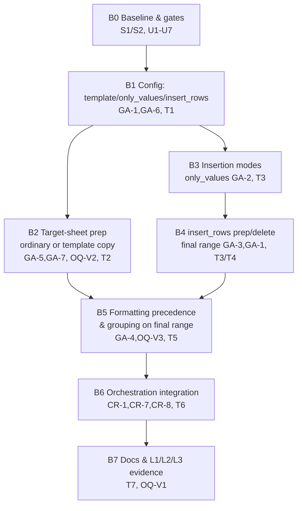

# Execution Plan: P04 — template-based subreport sheets and unified insertion parameters

- **Plan file:** `.ai/plans/007-p04-template-insert-execution.md`
- **Plan status:** Draft — decomposed for dependency-safe execution (baseline from spec + Step-0 `{code_context}`)
- **Date:** 2026-11-17
- **Scope mode:** Minimal, incremental, semantic (no speculative redesign). No VBA/code or existing audit phase files are modified by this planning step.
- **Source spec:** `.ai/problems/004_p04_template_insert_spec.md` (Status: Ready for implementation planning; GA-1..GA-7 recorded; CR-1..CR-8; T1–T7; OQ-V1..OQ-V3)

## 1. Source references and baseline

| Ref | Path / artifact | Role |
|---|---|---|
| S1 | `.ai/problems/004_p04_template_insert_spec.md` | Authoritative P04 requirements, PO decisions GA-1..GA-7, CR-1..CR-8, conceptual tasks T1–T7, OQ-V1..OQ-V3 |
| S2 | `{code_context}` (Step 0, task input, 2026-11-17) | Current-state evidence: config/run/extract/output/files baseline, implementation gaps, integration tensions, risks |
| S3 | `mko_treport/src/vbs/export/modTreportConfig.bas` (`TreportGeneral`, `TreportDataFile`, `ReadConfig`, `GetLO`/`ColIndex`/`HasColumn`, boolean/optional parsing precedent) | Config schema/types/validation and backward-compatible column handling |
| S4 | `mko_treport/src/vbs/export/modTreportRun.bas` (`Refresh_data`, `Create_report`, `ProcessDataFile`, per-output registries/collision, per-`data_files` orchestration) | Run orchestration, per-output sheet-name registry (`outUsedSheetNames`), placeholder resolution, paste/format/group sequence, fail-fast/cleanup |
| S5 | `mko_treport/src/vbs/export/modTreportOutput.bas` (`AddReportSheet`, `CleanupDefaultSheets`, `EnsureProducedSheetsPresent`, `SanitizeSheetName`, placeholder helpers, `SaveOutputWorkbook`) | Target-sheet creation, same-name handling, sheet naming/invariants, save |
| S6 | `mko_treport/src/vbs/export/modTreportExtract.bas` (`GetPresentedRange`, `CopyPivotSnapshot`, `ApplySheetFormatting`, `ApplyOutlineGrouping`) | Snapshot size/transfer, paste semantics, formatting (ActiveWindow/freeze/gridlines), outline grouping bounded to inserted range |
| S7 | `mko_treport/src/vbs/export/modTreportFiles.bas` | Deterministic source-file resolution (regression context) |
| S8 | `docs/01-vba-reporting/configuration-model.md`, `pipeline-and-dataflow.md` | Governed documentation to update (T7); currently pre-P04 |
| S9 | Project VBA workflow rules (`.kilo/rules/commands.md`, `.kilo/rules/project.md`) | Exports authoritative, no blind workbook edits, L1/L2/L3 gates, VBA identifier safety, working copies only |

**Evidence convention:** semantic units only (modules/procedures/types/ListObjects/config keys). Prior line references in `{code_context}` are context-only, not implementation anchors. Runtime Excel/VBE/Pivot/COM/template behavior is **not** proven by static analysis alone.

## 2. Overview and gap summary

P04 extends the subreport pipeline with two independent, combinable capabilities (CR-1): (1) **insertion control** `only_values`, `insert_rows` on any target sheet (GA-2, GA-3) and (2) **target-sheet preparation from template** `template` (GA-7). Size is derived from the actual snapshot (`H = snapshot.Rows.Count`, width = `snapshot.Columns.Count`) with **no `height/width` config columns** (GA-1). Structural row changes must complete before final-range determination, formatting, and grouping with template/report formatting precedence (GA-4). Parsing/defaults and fail-fast diagnostics follow GA-5/GA-6. All 8 valid combinations must work with backward compatibility (GA-6/CR-6).

**Current baseline (from `{code_context}`, not implemented):** exports/docs are pre-P04. `TreportDataFile`/`ReadConfig` have no `template`/`only_values`/`insert_rows` (runtime-tolerant optional-column precedent exists for `group_rows` and strict boolean precedent for `general.rows_collapsed`). `ProcessDataFile` creates a plain sheet via `AddReportSheet` (deletes same-named sheet), copies snapshot via `CopyPivotSnapshot` (3x PasteSpecial + row heights, no values-only/row-insert/delete), applies unconditional `ApplySheetFormatting` (clears FreezePanes/Gridlines, ActiveWindow-dependent), then `ApplyOutlineGrouping` on the immediate inserted range. `Create_report` maintains per-output `outUsedSheetNames` and fail-fast sheet-name collision (`2612`) before creation. Docs reflect pre-P04 behavior only.

**Integration tensions requiring resolution against current code (OQ-V2/OQ-V3, S1 §10):** `AddReportSheet` same-name delete vs GA-7 "no overwrite/delete on conflict"; unconditional formatting reset vs GA-4 template preservation/explicit overrides; grouping/freeze must use **final post-delete** range; helper-row deletion semantics and boundary at `paste_row=1`.

## 3. Assumptions and constraints (carried over)

- **Runtime/scope:** End-user behavior remains VBA-only in Excel (Excel 2021+/Windows, same instance for template copy/output ops, A-6). No external runtime dependencies.
- **Authoritative sources:** Edit `mko_treport/src/vbs/export/*.bas,*.cls` only as needed during implementation phases (not in this planning task). Macro workbook context is `ThisWorkbook` (`treport.xlsm`) for templates (A-1). Templates are Worksheets in `ThisWorkbook` (not text-verifiable from exports alone).
- **VBA workflow gates:** backup/working copy before verification; L1 `build_treport_vba.ps1` + report when exports change; **L2 manual `Debug → Compile VBAProject` on identified working copy required to claim compilation** (script compile is best-effort only); L3 functional checks on **copies** when behavior changes. No golden-output baseline.
- **Compatibility/invariants:** Preserve existing valid behavior except explicit P04 changes (CR-1/GA-6 absent/blank defaults). Configured-order processing and per-output invariants/registries remain deterministic. Fail-fast model preserved (GA-5/CR-7); no partial-formation/skip redesign.
- **No invention:** Follow GA-1..GA-7. Newly discovered edge cases outside decisions must be escalated/documented, not guessed for user-visible behavior.
- **Template immutability:** source templates in `ThisWorkbook` never modified (CR-2/GA-7).
- **OQ-V1:** detailed L3 acceptance matrix is **not mandatory before execution**; scenarios may be verified after implementation on working copies as needed (T7).

## 4. Technical uncertainty and "do not finalize approach" policy

Where runtime behavior, integration semantics, or Excel/COM object-model details cannot be proven from static evidence, this plan **does not choose a final implementation approach**. Affected blocks must run required agent gates (Auditor/Researcher/Planner/Validator as applicable), record evidence/options, and only then select the minimal safe design before coding.

| ID | Uncertainty | Affects | Required resolution (no speculative final choice without evidence) |
|---|---|---|---|
| U1 | **OQ-V2 / GA-7 conflict handling:** interaction of existing `ProcessDataFile` pre-creation collision check (`outUsedSheetNames`, `2612`) and `AddReportSheet` same-name delete with GA-7 "no overwrite/delete existing sheets on conflict where existing logic does not provide safe handling" for template and ordinary paths | B1, B2, B5 | Map current collision/registry invariants and define unified, deterministic conflict/error behavior and diagnostics consistent with GA-5/GA-7/CR-2; do not guess. |
| U2 | **OQ-V3 / GA-4 "explicitly set" precedence:** which `data_files`/formatting fields/count semantics constitute explicit report overrides for zoom/freeze/gridlines vs "not set => preserve template/current behavior"; current `ApplySheetFormatting` unconditionally resets freeze/gridlines | B1, B5, B6 | Derive from current config/schema and call semantics (e.g. blank/0/absent handling as today) and define conditional precedence contract; preserve ordinary-sheet behavior. |
| U3 | **GA-3 / CR-4 structural mechanics:** exact row-insert location/count and delete sequence to satisfy `P` final, temp insert `P+1..P+H`, helpers removed as whole rows (delete `P+H+1` then `P`), boundary `paste_row=1`, and correct re-determined final range `P..P+H-1` across Excel row-shift behavior | B4, B6 | Validate algorithm/edge cases on working copies or evidence-backed reasoning; keep helper-row deletion as separate callable function; do not hardcode in main path. |
| U4 | **GA-2 values-only transfer:** direct `Value`/`Value2` assignment vs alternatives for presented pivot snapshots (shape/compatibility, merged areas, formulas, dates) while preserving target/template formatting and not transferring widths/heights/number formats | B3, B6 | Select based on Excel/VBA behavior evidence and S1 intent (prefer direct assignment per GA-2) without breaking snapshot fidelity. |
| U5 | **Template copy fidelity/side effects:** `ThisWorkbook.Worksheets(...).Copy` preserves layout/merges/formulas/objects/print settings as needed; behavior for hidden/VeryHidden templates, name collisions in output, external links, and "never modify source template" under COM operations | B2, B6 | Confirm with evidence/tests on real templates in working copies; keep immutable-source and fail-fast diagnostics. |
| U6 | **Grouping/freeze post-structure correctness:** `ApplyOutlineGrouping` and freeze/layout must operate on final post-delete range/coords and remain bounds-scoped (CR-4/CR-5/GA-4); interaction with ActiveWindow/activated sheet | B5, B6 | Verify against current grouping contract and D6-like silent-skip behavior; define range handoff (inserted/final) semantically. |
| U7 | **GA-6 boolean contract for new params:** whether to reuse existing strict `rows_collapsed`-style validation/error code/context or introduce parallel parsing with consistent diagnostics and absent-column/blank defaults (including "TRUE/YES/1/FALSE/NO/0", trimmed, case-insensitive) | B1 | Align with existing config/error conventions; choose minimal consistent approach once audited. |

## 5. Execution blocks

### Block B0 — Baseline confirmation and decision-gate framing (completed for planning input)
- **Objective:** Confirm pre-P04 baseline, gaps, and uncertainties from S1/S2; freeze execution decomposition and gates (U1–U7).
- **Scope (semantic):** Read-only reconciliation of spec, `{code_context}`, exports, and docs; no code/doc changes.
- **Dependencies:** None.
- **Execution order:** 1 (completed as planning baseline).
- **Risks:** Static analysis may miss runtime/COM/template/workbook-state behavior; local-only artifacts/templates not text-verifiable.
- **Implementation alternatives:** N/A (planning). Verification approach alternatives (L3 scenario selection, template/test data sources) remain open per OQ-V1.
- **Required agents:**
  - **Auditor:** required (completed via `{code_context}`) — VBA/workbook/architecture baseline and gap/tension identification.
  - **Researcher:** optional/conditional — needed in later blocks for Excel/VBA/COM/template/row-shift/value-assignment behavior where uncertain.
  - **Planner:** required (this plan) — dependency-safe decomposition and gates.
  - **Validator:** recommended for plan review given high overall risk.
- **Acceptance:** Uncertainties U1–U7 mapped to blocks; order and gates defined.

### Block B1 — Config contract extension (`template`, `only_values`, `insert_rows`) (T1, CR-6, GA-1, GA-6)
- **Objective:** Read, default, parse, and validate `template`, `only_values`, `insert_rows` in `data_files` with backward-compatible absent/blank handling and contextual config errors; **no `height/width` columns**.
- **Scope (semantic):** `modTreportConfig` — `TreportDataFile` fields/types, `ReadConfig` column presence checks (`HasColumn` precedent) and row reads, boolean/value parsing per GA-6, defaults (template empty, booleans FALSE), fail-fast on non-empty unknown values with clear diagnostics.
- **Dependencies:** B0. Feeds B2–B6.
- **Execution order:** 2.
- **Risks:** Backward-compat break for older configs; ambiguous empty/absent semantics; inconsistent error codes/messages vs existing `rows_collapsed`/config validation; VBA identifier/reserved-word collisions in new symbols (must follow project rule).
- **Implementation alternatives (relevant):** reuse/adapt existing strict boolean parsing helper pattern vs dedicated parser for new fields; store template as trimmed string with empty-default normalization. **Do not finalize parsing/error-shape details if inconsistent with existing conventions until U7 is resolved.**
- **Required agents (HIGH RISK: config/schema + downstream impact):**
  - **Auditor:** required — confirm existing `ReadConfig`/`HasColumn`/error patterns and safe extension points.
  - **Researcher:** conditional — only if Excel cell/value coercion edge cases for GA-6 tokens are unclear.
  - **Planner:** required — atomic task spec and compatibility checks.
  - **Validator:** required — independent review of contract/default/error behavior before/after implementation.
- **Verification (on implementation):** L1 on working copy when exports change; **L2 manual VBE compile required to claim compile**; L3 on copies for old/new config rows (absent columns, blanks, valid/invalid values). No compile/behavior claim without evidence.

### Block B2 — Target-sheet preparation abstraction: ordinary vs template copy (T2, CR-1, CR-2, GA-5, GA-7, OQ-V2)
- **Objective:** Provide a single semantic entry point that yields a prepared, visible target worksheet in the output workbook for each subreport: existing ordinary creation path when `template` is empty/default, or fresh Worksheet copy from `ThisWorkbook` when filled; rename per `data_sheet` (existing rules), keep source template immutable.
- **Scope (semantic):** `modTreportOutput` / `modTreportRun` integration points — template lookup (Worksheet only, case-insensitive, visible/hidden/VeryHidden allowed), per-use copy into output workbook, final sheet visibility `xlSheetVisible`, name validation/normalization, fail-fast diagnostics including `data_sheet` and problematic parameter/template, and conflict handling.
- **Dependencies:** B0, B1. Must align with B6 orchestration and existing per-output invariants.
- **Execution order:** 3 (can proceed in design parallel with B3/B4 contract design, but integrated after contracts stable).
- **Risks:** **OQ-V2** (collision registry/`AddReportSheet` delete semantics vs GA-7 "no overwrite/delete"); accidental template mutation; copy failures/COM errors; chart/hidden sheet edge cases; name collisions; interaction with `CleanupDefaultSheets`/`EnsureProducedSheetsPresent` invariants.
- **Implementation alternatives (relevant, **do not finalize while uncertain**):**
  - Lookup/copy API shape (dedicated helper vs refactored `AddReportSheet`) — choose minimal safe option consistent with current invariants.
  - Conflict strategy: enforce GA-7 as explicit pre-check/fail-fast vs rely/adapt existing `2612`/deletion behavior — **must be resolved per U1/OQ-V2 with evidence**, not assumed.
  - Copy placement/activation details — only as needed for fidelity and ActiveWindow safety.
- **Required agents (HIGH RISK):**
  - **Auditor:** required — map current `AddReportSheet`, registry, cleanup/presence invariants and collision paths.
  - **Researcher:** required — Excel/VBA `Worksheet.Copy` behavior, template visibility/case-insensitive lookup, COM failure modes, hidden/VeryHidden handling.
  - **Planner:** required — contract for "prepared target sheet" and integration points.
  - **Validator:** required — review GA-7/GA-5/OQ-V2 compliance and no-overwrite/no-mutation guarantees.
- **Verification (on implementation):** L1, **L2 manual compile**, L3 on copies with real/working templates (found/not found/not worksheet, reuse same template, name conflict, hidden/VeryHidden, no source mutation).

### Block B3 — Snapshot insertion modes and `only_values` behavior (T3 part, CR-1, CR-3, GA-2)
- **Objective:** Support values-only insertion preserving target/template formatting/layout (no source formats/number formats/widths/heights) and preserve existing standard copy behavior when `only_values=FALSE`; operate identically on ordinary and template targets.
- **Scope (semantic):** `modTreportExtract` snapshot transfer path (e.g. `CopyPivotSnapshot` or split semantic helpers) used by `ProcessDataFile`; destination sizing from actual snapshot dimensions (`Rows.Count`/`Columns.Count`, GA-1/A-3).
- **Dependencies:** B0, B1 (parameter availability), B2 (prepared target contract for template cases in integration). Coordinates with B4/B6 for final-range handoff.
- **Execution order:** 3–4 (design/contracts early; implementation aligned with B4/B6).
- **Risks:** Date/number display loss on blank ordinary targets (GA-2/A-7) — by design but must be documented/verified; merged cells/formulas/pivot presented-range edge cases; performance/COM behavior differences; regressions in existing paste fidelity (formats/widths/row heights).
- **Implementation alternatives (relevant, **do not finalize while uncertain**):** direct `dst.Value = src.Value`/`Value2` assignment vs constrained copy approach for strict values-only (U4) — prefer GA-2 direction but confirm fidelity; keep standard path behaviorally equivalent to current multi-step paste when `only_values=FALSE`.
- **Required agents (HIGH RISK):**
  - **Auditor:** required — current `CopyPivotSnapshot` semantics, return range/size usage, and callers.
  - **Researcher:** required — `Value` vs `Value2`/assignment behavior for pivot ranges, dates/numbers, merged areas in Excel 2021.
  - **Planner:** required — mode split and interface/handoff for B4/B6.
  - **Validator:** required — GA-2 contract, no unintended format transfer, regression coverage plan.
- **Verification (on implementation):** L1, **L2**, L3 on copies (ordinary blank, preformatted, template targets; values-only vs standard; date/number display cases per GA-2/A-7).

### Block B4 — `insert_rows` row preparation and helper-row deletion (T3 part, T4, CR-1, CR-4, GA-1, GA-3, GA-5)
- **Objective:** Implement GA-3 model: `P = paste_row` is final first data row; when `insert_rows=TRUE` and `H = snapshot.Rows.Count > 0`, add `H` rows at `P+1`, temporarily insert into `P+1..P+H`, delete helper row `P+H+1` then `P` via a **separate callable function**, and re-determine actual final inserted range `P..P+H-1`. When `FALSE`, no row add/delete and insert at `P`.
- **Scope (semantic):** row-prep and cleanup helpers (separate operations per CR-8) plus insertion anchor/target-range computation integrated with `ProcessDataFile`/extract path; boundary handling including `paste_row=1`; fail-fast on invalid prep/insert/delete/height.
- **Dependencies:** B0, B1. Requires snapshot height/width knowledge (B3/extract contract) and integrates with B6 ordering.
- **Execution order:** 4.
- **Risks:** **U3** coordinate/shift errors, off-by-one, wrong delete order, Excel row limits/boundary behavior, corruption of template/target content if helper rows not expendable (A-4), failure to recompute final range for downstream steps.
- **Implementation alternatives (relevant, **do not finalize while uncertain**):** exact insert/delete API calls and range-addressing strategy; where to compute/store `H`/width and final range (return value vs out params/typed result) — choose minimal, semantic handoff; no hardcoded deletion in main algorithm. Validate GA-3 sequence against Excel behavior before coding.
- **Required agents (HIGH RISK):**
  - **Auditor:** required — current anchor/range derivation and downstream consumers (formatting/grouping).
  - **Researcher:** required — Excel `Rows.Insert`/`Rows.Delete` shift semantics, whole-row deletion, `paste_row=1` boundary, large `H` behavior.
  - **Planner:** required — separate-function contract and stage inputs/outputs.
  - **Validator:** required — GA-3 correctness, boundary cases, and fail-fast diagnostics.
- **Verification (on implementation):** L1, **L2**, L3 on copies (`paste_row=1`, multiple `H`, ordinary/template, with/without `only_values`, adjacent content boundaries as applicable).

### Block B5 — Post-processing integration: formatting precedence and grouping on final range (T5, CR-5, GA-4, OQ-V3, U2, U6)
- **Objective:** Apply GA-4 stage order and precedence: after structural changes, determine final inserted range, apply sheet formatting considering report settings and template (preserve template/current settings unless explicitly overridden), then apply `ApplyOutlineGrouping` on **final** coordinates/bounds.
- **Scope (semantic):** `modTreportExtract` (`ApplySheetFormatting`, grouping call contract) and `modTreportRun.ProcessDataFile` sequencing/range handoff; conditional behavior for template vs ordinary sheets; zoom/freeze/gridlines precedence mapping.
- **Dependencies:** B2, B3, B4 contracts implemented or interface-stable; B1 for config context.
- **Execution order:** 5.
- **Risks:** **U2/OQ-V3** incorrect "explicitly set" interpretation causing template settings to be wiped or overrides ignored; **U6** grouping/freeze on pre-delete coords; ActiveWindow dependency regressions; interaction with existing grouping silent-skip semantics and bounds.
- **Implementation alternatives (relevant, **do not finalize while uncertain**):** explicit-override detection strategy (sentinel/tri-state/column-presence/value checks) and formatting API refactor shape — resolve via U2 evidence against current config semantics; pass final `Range`/bounds object from insertion pipeline rather than recomputing implicitly.
- **Required agents (HIGH RISK):**
  - **Auditor:** required — current `ApplySheetFormatting` behavior, grouping inputs/bounds, and template-vs-ordinary call sites.
  - **Researcher:** conditional/required if ActiveWindow/freeze/gridlines/outline behavior is ambiguous across template copies.
  - **Planner:** required — GA-4 sequence and precedence contract.
  - **Validator:** required — regression and precedence review.
- **Verification (on implementation):** L1, **L2**, L3 on copies (ordinary path unchanged, template preserves zoom/freeze/gridlines when not overridden, explicit overrides win, grouping/freeze correct after helper-row deletion).

### Block B6 — Pipeline/orchestration integration and end-to-end sequencing (T3–T6 integration, CR-1, CR-7, CR-8, GA-4, GA-5)
- **Objective:** Wire config, target preparation, insertion/row-prep/delete, formatting, and grouping into the correct `ProcessDataFile`/`Create_report` lifecycle with unified per-subreport flow (no duplicated normal-vs-template insertion logic) and preserved fail-fast/cleanup invariants.
- **Scope (semantic):** `modTreportRun` per-`data_files` sequence, handoff of prepared sheet/snapshot/final range/context, diagnostics propagation (`data_sheet` + problematic parameter/template), interaction with existing registries/placeholders/filters and D3-like output finalization invariants as currently implemented.
- **Dependencies:** B1–B5.
- **Execution order:** 6.
- **Risks:** Ordering/state leakage across subreports or outputs, broken collision/cleanup invariants, partial operations on failure (must remain fail-fast/close-no-save per current model), error-context loss.
- **Implementation alternatives (relevant):** orchestration helper extraction vs inline sequencing in `ProcessDataFile` — choose smallest maintainable option once contracts are fixed; do not redesign run architecture.
- **Required agents (HIGH RISK):**
  - **Auditor:** required — end-to-end lifecycle, error handlers, registries, and invariants.
  - **Researcher:** conditional — only for COM/error-path behavior uncovered in integration.
  - **Planner:** required — definitive ordered step list and responsibility boundaries (CR-8).
  - **Validator:** required — integration, non-regression, and GA-5 diagnostic completeness review.
- **Verification (on implementation):** L1, **L2**, L3 combined scenarios (all 8 combinations representative, template/ordinary, offsets/placeholders/grouping coexistence unaffected except intended integration points, failure paths).

### Block B7 — Documentation and verification plan/evidence capture (T7, CR-6, OQ-V1)
- **Objective:** Align governed docs with finalized P04 behavior and capture/record L1/L2/L3 evidence and recommended post-implementation scenarios (matrix optional, per OQ-V1).
- **Scope (semantic):** `docs/01-vba-reporting/configuration-model.md`, `docs/01-vba-reporting/pipeline-and-dataflow.md`; verification notes/reports under `.ai/tmp` or ignored paths as appropriate. No changes to canonical data/original workbooks.
- **Dependencies:** B1–B6 behavior finalized/implemented as applicable.
- **Execution order:** 7.
- **Risks:** Documenting undecided behavior (U1–U7 unresolved), missing regression cases, environment blockers preventing L2/L3 evidence (VBOM trust, Excel/COM, workbook locks, template availability), overclaiming compile/behavior.
- **Implementation alternatives (relevant):** minimal incremental doc updates vs broader restructure — prefer minimal evidence-based updates. Scenario selection/data sources for L3 chosen based on availability on working copies; do not require predefined matrix for execution start.
- **Required agents (HIGH RISK for evidence/closure quality):**
  - **Auditor:** required — reconcile docs with implemented semantic contracts and evidence artifacts.
  - **Researcher:** conditional — interpret Excel/Pivot/COM/template anomalies during L3.
  - **Planner:** required — verification checklist and residual-gap recording.
  - **Validator:** required — independent review of evidence sufficiency, L2 gate compliance, and no unsupported claims.
- **Verification:** L1 report path/result recorded when exports change; **L2 explicitly PASS with working-copy identity/date-time or explicitly NOT DONE/BLOCKED** (never claimed without pass); L3 scenario outcomes recorded on copies when performed (including recommended cases from T7: 8 combinations, `paste_row=1`, invalid params, template missing/conflict, date/number display, freeze/gridlines/zoom/grouping precedence).

## 6. Dependency and execution order

| Order | Block | Depends on | Gate / notes |
|---|---|---|---|
| 1 | B0 Baseline and decision-gate framing | — | Completed for planning (S1/S2) |
| 2 | B1 Config contract extension | B0 | Resolve/record U7; compatibility-first |
| 3 | B2 Target-sheet preparation (ordinary/template) | B0, B1 | **U1/OQ-V2, U5** unresolved => no final approach choice; Researcher+Validator gates required |
| 4 | B3 Insertion modes / `only_values` | B0, B1 (and B2 contract for integration) | **U4** unresolved => no final transfer approach choice without evidence |
| 5 | B4 `insert_rows` prep + helper-row delete + final range | B0, B1, B3 snapshot-size contract | **U3** unresolved => validate GA-3 mechanics before coding |
| 6 | B5 Formatting precedence + grouping on final range | B2–B4 | **U2/OQ-V3, U6** unresolved => no final precedence/range-handoff choice without evidence |
| 7 | B6 Pipeline/orchestration integration | B1–B5 | Unified sequence, GA-5 diagnostics, invariant preservation |
| 8 | B7 Documentation and verification/evidence | B1–B6 (as implemented) | **L2 manual gate**; L3 on copies post-implementation allowed (OQ-V1) |

**Indicative critical path:** B0 → B1 → (B2 & B3 contract work, then B4) → B5 → B6 → B7. B2/B3 can be analyzed in parallel after B1, but integration must respect resolved contracts and B4/B5 sequencing.



## 7. Agent requirements by block (summary)

| Block | Risk level | Auditor | Researcher | Planner | Validator | Rationale |
|---|---:|---|---|---|---|---|
| B0 | Medium (planning) | Required (done) | Conditional (later) | Required (done) | Recommended | Baseline/gap/uncertainty framing |
| B1 | **High** | Required | Conditional | Required | Required | Schema/parse/defaults affect all flows; compatibility and diagnostics |
| B2 | **High** | Required | Required | Required | Required | Template copy, invariants, collision/OQ-V2, COM/runtime behavior |
| B3 | **High** | Required | Required | Required | Required | Values-only semantics/fidelity, Excel transfer behavior, regressions |
| B4 | **High** | Required | Required | Required | Required | Row-shift algorithm (GA-3), boundaries, final-range correctness |
| B5 | **High** | Required | Conditional/Required | Required | Required | Formatting precedence (OQ-V3), final-range grouping/freeze, ActiveWindow |
| B6 | **High** | Required | Conditional | Required | Required | End-to-end sequencing, fail-fast/cleanup, unified pipeline integrity |
| B7 | **High** | Required | Conditional | Required | Required | Evidence quality, L2 gate, no unsupported claims, doc/behavior alignment |

**Policy:** All high-risk blocks require Auditor, Researcher, Planner, and Validator participation (Researcher conditional only where uncertainty is already fully resolved by evidence; in practice B2/B3/B4 should include Researcher due to Excel/COM behavior). No implementation approach is finalized in blocks with open technical uncertainty (U1–U7) until required evidence/agent review resolves it.

## 8. Cross-cutting verification matrix

| Requirement / decision | Primary blocks | L1 (working copy, scripted) | L2 (manual VBE, user/operator gate) | L3 (copies only) minimum intent |
|---|---|---|---|---|
| CR-1/CR-8, all 8 combinations | B1–B6,B7 | Required when exports change | **Required to claim compile** | Representative ordinary/template × `only_values` × `insert_rows` scenarios |
| GA-1, CR-4 (`H`/width from snapshot, no `height/width`) | B1,B3,B4,B6,B7 | Required | Required | Actual snapshot-sized insertion; `H>0`; correct final bounds |
| GA-2, CR-3 (`only_values`) | B3,B6,B7 | Required | Required | Strict values-only preserves target/template; standard path unchanged; blank vs preformatted/template display (A-7) |
| GA-3, CR-4 (`insert_rows`, final `P`, helper delete separate fn) | B4,B6,B7 | Required | Required | `paste_row=1`, helper delete order `P+H+1` then `P`, final `P..P+H-1`, no row ops when FALSE |
| GA-4, CR-5 (stage order, formatting/grouping precedence, final coords) | B5,B6,B7 | Required | Required | Template preserved unless explicit override; ordinary behavior preserved; grouping/freeze on final range |
| GA-5, CR-2, CR-7 (fail-fast diagnostics incl. `data_sheet` + parameter/template) | B1,B2,B4,B6,B7 | Required | Required | Template not found/unusable/copy/name/conflict, invalid params, row/insert errors; no partial formation |
| GA-6, CR-6 (boolean parsing/defaults/backward compat) | B1,B7 | Required | Required | Absent column/blank => defaults; valid TRUE/FALSE tokens; non-empty unknown => config error |
| GA-7, CR-2 (template lookup/copy/immutability/visibility/naming) | B2,B6,B7 | Required | Required | `ThisWorkbook` Worksheet only, case-insensitive, visible/hidden/VeryHidden, fresh visible copy per use, source unchanged, reuse allowed |
| OQ-V2, OQ-V3 (integration details) | B2,B5,B6,B7 | Required | Required | Deterministic collision/override behavior evidenced and documented |
| CR-6 (non-regression) | B1–B7 | Required | Required | Existing filters/placeholders/grouping/sheet naming/save/cleanup invariants preserved except intended P04 changes |

## 9. Risk register

| ID | Area | Risk | Likelihood | Impact | Affected blocks | Mitigation / gate |
|---|---|---|---:|---:|---|---|
| R1 | GA-3 / U3 | Coordinate/shift errors in prep/insert/delete; wrong helper delete order; `paste_row=1` edge case | High | High | B4,B5,B6,B7 | Enforce exact GA-3 algorithm in separate function, recompute final range `P..P+H-1`, Auditor/Researcher/Validator, L3 boundary cases on copies |
| R2 | GA-2 / U4 | Values-only transfer loses date/number display or transfers unintended formatting/dimensions | Medium | High | B3,B6,B7 | GA-2 contract + A-7, evidence-based transfer choice, template/preformatted target scenarios, regression on standard path |
| R3 | GA-4 / U2,U6 | Template settings wiped or overrides ignored; grouping/freeze applied on pre-delete coords | High | High | B5,B6,B7 | Resolve OQ-V3 precedence, pass final range, conditional formatting logic, ordinary-path regression checks |
| R4 | GA-7 / U1,U5 | Template lookup/copy side effects, source mutation risk, conflict handling inconsistent with registries/invariants | Medium | High | B2,B6,B7 | Immutable-source checks, fail-fast diagnostics, OQ-V2 resolution against existing collision/cleanup invariants, L3 on real templates/copies |
| R5 | GA-6 / CR-6 | Backward-compat break for existing configs or ambiguous parsing/error behavior | Medium | High | B1,B7 | Absent/blank defaults, no required `height/width`, align with existing parsing/error conventions (U7), regression scenarios |
| R6 | GA-5 / CR-7 | Missing or unclear diagnostics; partial side effects before fail-fast stop | Medium | Medium/High | B1,B2,B4,B6 | Contextual errors including `data_sheet` + parameter/template; preserve close-no-save/cleanup behavior; Validator review |
| R7 | OQ-V2 | Tension between `AddReportSheet` same-name delete and GA-7 no-overwrite/no-delete conflict rule | High | High | B2,B6 | **Do not finalize approach without evidence**; Auditor maps invariants, Validator approves contract |
| R8 | Environment/runtime | Excel/COM/ActiveWindow behavior, macro security/VBOM, workbook locks (`~$`), Power Query/pivot refresh timing/state, template availability | Medium | High | B2–B7 | Working copies only, explicit L1/L2/L3 status, environment blocker recording, no claims without evidence |
| R9 | Fidelity/maintainability | Output layout/print/objects differ from template expectations; duplicated logic introduced | Medium | Medium | B2,B3,B4,B6 | Unified pipeline/CR-8 separation, L3 on representative real templates, minimal refactor |
| R10 | Verification gap | Insufficient scenario coverage because OQ-V1 matrix is optional; regressions missed | Medium | Medium/High | B7 | T7 recommended scenarios checklist, risk-based selection on available copies, explicit recorded outcomes/blockers |

## 10. Implementation- and verification-time deliverables (when executed)

- **Changed exports (if implementation proceeds):** only required semantic units in `mko_treport/src/vbs/export/{modTreportConfig,modTreportRun,modTreportExtract,modTreportOutput}.bas` (and others only if evidenced necessary). Follow VBA identifier safety and no line-number targeting.
- **Docs:** minimal updates to `docs/01-vba-reporting/configuration-model.md` and `pipeline-and-dataflow.md` reflecting finalized P04 contract/flow (T7).
- **Evidence:** L1 command + `.ai/tmp/build_treport_vba_<timestamp>.txt` summary; **L2 manual VBE compile** PASS/FAIL/NOT PERFORMED with working-copy identity/date-time; L3 scenarios/outcomes on copies (optional matrix, OQ-V1).
- **Traceability:** record resolutions for U1–U7/OQ-V2/OQ-V3 and any deviations/escalations against GA-1..GA-7.

## 11. Notes and non-goals

- No speculative redesign of report architecture, pivot/filter/placeholder algorithms, PQ logic, or source data files beyond necessary P04 integration without regression.
- No `height/width` columns (GA-1), no partial/skip-on-error redesign (GA-5), no golden-output baseline, no automated compile proof beyond L1/L2/L3 evidence.
- Do not modify canonical workbooks blindly; do not corrupt originals; keep working copies/reports in `.ai/tmp` or ignored paths as appropriate.
- **Orchestrator note:** "If stop or break prefer resume old session not launching new agent" — execution should be checkpointed per block/gate so resumed sessions can continue from last recorded decision/evidence without redoing completed analysis.

## 12. Definition of ready for block execution

- [x] Spec S1 is ready for implementation planning (GA-1..GA-7, CR-1..CR-8, T1–T7, OQ-V1..OQ-V3 recorded).
- [x] Baseline gaps/tensions and risks captured from `{code_context}` (S2).
- [x] Dependency-safe blocks, per-block agent requirements, and uncertainty gates (U1–U7) defined.
- [x] L2/L3 evidence rules and "no final approach when uncertain" policy stated.
- [x] **B1 Auditor (Step 3.1, 2026-11-17):** current config contract/validation/optional-column/boolean/error conventions and U7 evidence options documented in §13 (no VBA/code/audit-phase-file changes; U7 not finalized).
- [~] Implementation-time resolutions for U1–U7/OQ-V2/OQ-V3 — to be completed with required agents/evidence before finalizing affected designs. **B1/U7:** implementation guidance recorded in §15 (A1-style contingent, strict GA-6 parity, `HasColumn` defaults, `IsError` explicit fail-fast, GA-5 diagnostics incl. `data_sheet`; exact helper/error-code/member identifiers to be verified/aligned with local `modTreportConfig` conventions during implementation and Validator review). U1–U6/OQ-V2/OQ-V3 remain open for B2–B6.
- [ ] Post-implementation L3 scenarios executed/recorded as needed (OQ-V1, not a pre-execution blocker).
- [ ] Doc updates applied with implementation (T7).

**Planning outcome:** This execution plan is suitable for staged implementation, but affected blocks must not finalize technically uncertain approaches until their Auditor/Researcher/Planner/Validator gates produce evidence-based decisions consistent with GA-1..GA-7.

## 13. B1 Auditor findings (Step 3.1, 2026-11-17)

**Scope audited (read-only, semantic):** `modTreportConfig.bas`, `modTreportRun.bas` (`ProcessDataFile`/`Create_report`), `modTreportOutput.bas` (`SanitizeSheetName`, `EnsureNoSheetNameCollision`, `AddReportSheet`, `CleanupDefaultSheets`, `EnsureProducedSheetsPresent`), `modTreportExtract.bas` (`GetPresentedRange`, `CopyPivotSnapshot`, `ApplySheetFormatting`, `ApplyOutlineGrouping`), `docs/01-vba-reporting/configuration-model.md`, S1/S2/plan constraints. **No VBA/code or existing audit phase files modified.**

### 13.1 Config schema and read contract (`modTreportConfig`)

- **Types:** `TreportGeneral` fields `inputPath`, `outputPath`, `Delimeter`, `rowsCollapsed As Boolean`. `TreportDataFile` fields `DataFile`, `DataSheet`, `ReportSheet`, `Filters` (String), `pasteRow/pasteCol/freezeRow/freezeCol/Zoom/GroupRows` (Variant), `RowIndex` (Long). **No `template`, `only_values`, `insert_rows`, `height`, `width` members exist** (GA-1 extension point open).
- **`ReadConfig(wb)` flow:** loads `settings` worksheet (`GetSettingsWs`, `2100` if missing) and required LOs `general/reports/data_files/placeholders` via `GetLO` (`2101`). Required-column lookup is fail-fast via `ColIndex` (`2102` "Required column '<col>' was not found in ListObject '<lo>'"). Row iteration uses `RowCountSafe`/`DataBodyRange`; empty required tables fail (`2103/2109/2113`).
- **`general` parsing:** key/value rows read by `Norm(loG...("parameter"))` and raw `pValRaw`/`Norm` of `value`. Required params validated post-loop: `input_path` `2104`, `output_path` `2105`, `delimeter` `2106` (non-empty). `rows_collapsed` is the only boolean-like general param today (see §13.3).
- **`reports` parsing:** per-row `CellText` for `articleLevel4Name_clean/targetAudience/name`, required checks `2110/2111/2112` with row/name context.
- **`data_files` parsing:** required columns always read via `CellText`/`CellVal`/`ColIndex` (`data_file/data_sheet/report_sheet/filters/paste_row/paste_col/freeze_row/freeze_col/zoom`) and required non-empty checks `2114-2117` with row/data_file context. **Optional-column precedent:** only `group_rows` is guarded by `HasColumn(loD,"group_rows")` then `CellVal`; if column absent the field is left at default Variant state (no error). No other optional `data_files` columns exist.
- **Helpers/semantics:** `Norm` trims and maps error/null/empty to empty string (used widely for required text checks). `CellVal` uses `ColIndex` (fail-fast if column missing) and returns raw cell `.value` (or `Empty` if no data body). `CellText` = `Norm(CellVal)`. `Fail(code,ctx,msg)` raises `vbObjectError + code` with source `"treport"` and message `ctx & ": " & msg`.

### 13.2 Error-code and diagnostic conventions (relevant ranges)

- **Config (`modTreportConfig`):** `2100-2107,2109-2117,2120-2123` (structures/required params/required columns/invalid `rows_collapsed`, path readiness). Context is section/row/identity-aware (e.g. `config/general`, `config/reports[row=..,name=..]`, `config/data_files[row=..,data_file=..]`).
- **Output/naming/collision/finalization (`modTreportOutput`, `modTreportRun`):** sheet/file name validation `2601-2603`, collision helpers `2604`, creation/save `2608-2610`, per-output namespace collision `2612` (raised in `ProcessDataFile` before `AddReportSheet`), default-sheet cleanup/presence invariants `2620-2629`, missing-produced-sheets save guard `2630`.
- **Max-placeholder/report-sheet resolution (`modTreportOutput`/`modTreportRun`/`modTreportPivot`):** `2613-2619,2631-2633` with rich template/field/N/token/max context.
- **Extract/grouping (`modTreportExtract`):** presented range/copy failures `2701-2702`; grouping COM failure after validation `2703`. **Parameter-invalid/missing group_rows cases are non-fatal skips with `Debug.Print` diagnostics** (`GroupingSkipDiagnostic`), not `Fail`.
- **Implication for B1:** new `data_files` parameter parse/validation errors must include `data_sheet`/row and problematic parameter/value per GA-5/GA-6; exact code selection should follow existing config-domain allocation/style once finalized (U7), but current convention shows explicit, contextual `Fail` for config invalid-value cases.

### 13.3 Boolean/optional-column precedents (critical for U7)

- **Strict general boolean (`general.rows_collapsed`):** default `False`; if raw value `IsEmpty`/`IsNull` => `False`; if `VarType = vbBoolean` => `CBool`; if `Len(pVal)=0` => `False`; else case-insensitive `LCase$(pVal)` accepts `false/0/no` => `False`, `true/1/yes` => `True`; **any other non-empty value fails fast** with `2107` and message "expected blank, False/0/No, or True/1/Yes" including row/section/raw value.
- **Optional column + runtime-tolerant param (`data_files.group_rows`):** column presence checked by `HasColumn`; absent column => no read/error (backward compatible). Value is passed as raw Variant to `ApplyOutlineGrouping`, which performs its own deterministic validation: missing/blank/`0`/object/error/non-numeric/fractional/out-of-range/out-of-width => **skip with explicit diagnostic** (no fail-fast). This is intentionally permissive at config-read time for that feature.
- **GA-6 vs precedents (evidence, not decision):** GA-6 requires absent column/blank => default, accepts TRUE/YES/1/FALSE/NO/0 (trimmed, case-insensitive), and **non-empty unknown => config error (fail-fast)**. Token set and trim/case rules align with `rows_collapsed`, but GA-6 scope differs (new `data_files` booleans, plus `template` string default). Reusing/adapting strict parse shape is behaviorally closer for "unknown => error" than `group_rows`'s runtime-skip model; however `group_rows` establishes `HasColumn` for backward-compatible new columns and a context style that can carry `data_sheet`/row/parameter identity.

### 13.4 Integration and compatibility context relevant to B1 consumers

- **Per-subreport identity/context available:** `ProcessDataFile` builds `fileCtx`/`repCtx` with `data_file`, row, sheet, report, `report_row`, and later output name; `cfg.DataFiles(dfIdx).DataSheet`/`RowIndex` are natural anchors for GA-5/GA-6 diagnostics. `ReadConfig` currently includes row and sometimes `data_file/name` in config errors but not consistently `data_sheet` for `data_files` rows.
- **Optional numeric/layout fields today:** `pasteRow/pasteCol/freezeRow/freezeCol/Zoom/GroupRows` are Variants read from required (layout) or optional (`group_rows`) columns without config-time range/type coercion beyond later use; `ProcessDataFile` defensively normalizes paste anchors to >=1. This differs from GA-6 booleans which must error on unknown non-empty tokens.
- **Registry/collision tension (U1 context):** `ProcessDataFile` enforces per-output final-name uniqueness via `outUsedSheetNames` (`2612`) before sheet creation; `AddReportSheet` also deletes same-named existing sheet in target workbook. B2 must reconcile with GA-7 no-overwrite/delete-on-conflict — B1 config extension alone must not alter this behavior.
- **Formatting/grouping handoff (U2/U6 context):** `ApplySheetFormatting(ws,freezeRow,freezeCol,zoomVal,...)` unconditionally clears freeze/gridlines and uses `ActiveWindow`; `ApplyOutlineGrouping(insertedRng,GroupRows,general.rowsCollapsed,...)` depends on inserted bounds and `rows_collapsed`. New fields will need to be threaded through this pipeline in later blocks with resolved precedence/final-range semantics.

### 13.5 Risks/compatibility concerns (B1-focused)

- **Backward compatibility:** adding required columns for `template/only_values/insert_rows` would break older configs (`ColIndex` fail-fast) — conflicts with GA-6 "missing column => default". `HasColumn` + defaulting is the established safe pattern (as for `group_rows`).
- **Default semantics:** `template` default empty string and booleans default `False` must be explicit and deterministic for absent-column, `Empty/Null`, and blank-string cases (note `Norm` maps empty/error-like to `""`, `CellVal` may return `Empty`).
- **Token/raw-value handling:** `rows_collapsed` inspects raw `pValRaw` for `vbBoolean`/`IsEmpty`/`IsNull` and trimmed string tokens; GA-6 includes Excel TRUE/FALSE and 1/0 — consistent with this style, but must be applied per-field with field-specific diagnostics.
- **Error context quality:** GA-5/GA-6 expect actionable messages including `data_sheet` and problematic parameter; current `data_files` validation messages include row and `data_file` (for some checks) but not `data_sheet` or parameter name consistently — extension is an opportunity but must remain consistent.
- **VBA identifier safety:** planned symbol names like `template`, `onlyValues`/`only_values`, `insertRows`/`insert_rows` must be checked against VBA reserved words/built-ins and case-insensitive collisions before implementation (project rule). No new identifiers introduced in this audit step.

### 13.6 U7 evidence/options (not finalized)

| Option | Evidence for alignment | Evidence/risks against | When safer |
|---|---|---|---|
| **Reuse/adapt strict `rows_collapsed`-style parsing** (raw-type checks + trimmed case-insensitive token set + fail-fast on non-empty unknown) | Matches GA-6 "unknown non-empty => config error" and accepted tokens (`TRUE/FALSE/YES/NO/1/0`); existing `2107` pattern proves expected message shape ("expected blank, ... or ..."); uses `Norm`/raw Variant already in `ReadConfig`. | `rows_collapsed` is general-scope with dedicated code `2107`/wording; direct reuse without adaptation would duplicate/entangle contexts. New fields live in `data_files` rows and need parameter-specific, `data_sheet`-aware diagnostics per GA-5/GA-6. | If factored into a semantic helper that takes `(raw, paramName, rowCtx[, dataSheet])` and emits consistent fail-fast diagnostics/codes per existing config conventions. |
| **Parallel parsing with consistent diagnostics/defaults** (new helper(s) for `template` string and GA-6 booleans) | Can encode `HasColumn` absent-column defaulting, blank/empty/null handling, GA-6 tokens, and GA-5 `data_sheet`+parameter context in one place; avoids overloading `group_rows` runtime-skip semantics. | Risk of diverging token acceptance/error wording/code range from `rows_collapsed` unless explicitly aligned; more code surface to validate. | Preferred if it preserves behavioral parity with strict boolean contract and existing `Fail`/context style; must be reviewed for consistency (Validator gate). |
| **Follow `group_rows` runtime-tolerant/skip model** | Uses `HasColumn` precedent for backward compat. | **Conflicts with GA-6** for non-empty unknown values (would need to be error, not skip) and moves validation away from config-read fail-fast. | Not suitable as-is for GA-6 booleans; only `HasColumn`/defaulting aspect is transferable. |

**Evidence-based notes:** (1) `HasColumn` is mandatory for new P04 columns to satisfy "missing column => default" without `2102`. (2) Boolean parsing should treat Excel Boolean/`IsEmpty`/`IsNull`/blank/trimmed tokens explicitly like `rows_collapsed` to meet GA-6 while remaining backward compatible. (3) `template` is string-valued (default empty) and not boolean; it should not be forced through boolean parser. (4) Final error-code/context shape remains open until aligned with existing conventions (U7) — do not finalize implementation choice here.

### 13.7 Audit artifacts/constraints

- Existing audit phase files present and untouched: `.ai/audit/problems/001-treport-spec-vs-implementation-discrepancies.md`, `.ai/audit/problems/2026-11-17-treport-spec-plan-implementation-discrepancies.md`.
- No L1/L2/L3 executed (read-only audit); no compile/behavior claims. Uncertainties U1–U6 remain as planned.

## 14. B1 Researcher findings (Step 3.2, 2026-11-17)

**Scope (read-only, semantic):** B1 config contract only (`modTreportConfig` `TreportDataFile`/`ReadConfig`), GA-1/GA-5/GA-6/CR-6/T1, U7, and minimal interface implications for B2–B6. Sources: S1/S2/S3/S8, plan §13, `.kilo/rules/project.md` (VBA identifier safety). **No VBA/code or existing audit phase files modified. No final implementation choice declared where U7/conventions remain open.**

### 14.1 Excel/VBA behavior considerations relevant to GA-6 parsing/coercion (evidence-backed)

| Input case | VBA/Excel-relevant behavior | GA-6 contract implication for B1 |
|---|---|---|
| Native Boolean cell (`TRUE`/`FALSE`) | `VarType(v)=vbBoolean`; `CBool` preserves logical value. `rows_collapsed` already accepts this path (`modTreportConfig` strict parse). | Accept as valid TRUE/FALSE without string conversion ambiguity. |
| Numeric `1` / `0` | Excel stores numeric values distinctly from booleans; numeric `1`/`0` may arrive as numeric Variants. GA-6 explicitly accepts `1`/`0`. | Parse numeric-equivalent tokens deterministically (exact 1/0 semantics must be defined consistently with existing style) while still rejecting other numbers as unknown non-empty values. |
| Text tokens `TRUE/FALSE/YES/NO` (any case, spaces) | `Norm`/`Trim$` + `LCase$` comparison is the established repo pattern; string tokens are locale-spelling-sensitive in Excel UI but spec enumerates English tokens — treat listed tokens literally after trim/case-fold. | Accept trimmed, case-insensitive listed tokens only; do not accept localized synonyms unless spec later expands. |
| Blank/empty cell, `IsEmpty`, `IsNull` | `CellVal` may return `Empty` when no data body/value; `Norm` maps empty/error/null-like to empty string. `rows_collapsed` treats empty/null/blank as default False. | Map absent-column, `Empty/Null`, and blank string to GA-6 defaults (`template=""`, booleans `False`) deterministically. |
| Error cell (`#N/A`, `#VALUE!`, etc.) | `IsError(v)=True`; `Norm` returns empty string (current helper behavior), but raw `IsError` can distinguish malformed/error input from intentional blank. | **Uncertainty (behavioral policy):** spec states "non-empty unknown value => config error" and "empty cell => default"; treating error cells as blank could hide config issues. Preferred contract should detect `IsError` explicitly before blank-defaulting and fail fast with contextual diagnostics if treated as non-empty invalid input; final choice must align with existing `ReadConfig`/`Fail` conventions (U7-adjacent convention check). |
| Non-empty unknown (`2`, `Y`, `maybe`, arbitrary text) | Must not be coerced to False/True silently. | Fail-fast config error with `data_sheet`/row/parameter/raw value context (GA-5/GA-6). |

**VBA/maintainability note:** parsing should be centralized (single semantic helper per boolean contract or per field-type contract) to avoid drift between `rows_collapsed` and new `data_files` booleans and to keep accepted-token/error-message parity testable by inspection and L3 scenarios.

### 14.2 Backward-compatible optional-column handling (GA-6, CR-6)

- **Required pattern:** `HasColumn(loD, <name>)` guard before `CellVal`/`ColIndex` read, same precedent as `group_rows` (`modTreportConfig.ReadConfig`). `ColIndex` is fail-fast `2102` and therefore unsafe for newly introduced optional columns in older configs.
- **Column-absent:** treat as default without error (`template=""`, `only_values=False`, `insert_rows=False`).
- **Column-present but empty/blank:** treat as default (GA-6). Do not require `height/width` columns (GA-1).
- **No schema mutation side effects:** B1 only extends read/type/validation contract; it must not change existing required-column checks, row iteration/order, or per-output registries/collision behavior (R5, B6 integration boundary).

### 14.3 Diagnostics and error-convention alignment (GA-5, GA-6)

- **Context required:** config/read-time failures for P04 fields should identify `config/data_files[row=...,data_file=...,data_sheet=...]` (or equivalent existing style), parameter/column name, and raw problematic value/template token as applicable. `ReadConfig` already has row/data_file context in several checks (`2114-2117`) but not consistently `data_sheet`/parameter — GA-5 is stricter.
- **Code allocation (convention-sensitive):** `modTreportConfig` currently uses `2100-2107,2109-2117,2120-2123`. `2107` is specific to `general.rows_collapsed`; reusing it for `data_files` booleans may reduce specificity unless message/context is parameterized. Introducing adjacent codes in the config range is plausible, but exact numbering must follow existing allocation conventions and avoid collisions — **do not finalize code numbers in this research step**.
- **Message style:** follow existing actionable `Fail` pattern (`ctx & ": " & msg`) with explicit expectation text (like `rows_collapsed`: "expected blank, ..."). Keep diagnostics deterministic and non-ambiguous for L3 failure cases (invalid params, unknown tokens).

### 14.4 VBA identifier-safety precheck (project rule, pre-implementation)

| Candidate identifier (case-insensitively) | Risk assessment (static, HIGH confidence for obvious keywords) | Recommendation |
|---|---|---|
| `template` (field/param/variable) | **Low apparent keyword risk** (not a VBA statement/built-in keyword in common core set), but common object/property naming can create readability collisions; must still be checked against project symbols and VBA members in scope. | Acceptable candidate **subject to implementation-time verification**; prefer clear local names if shadowing concerns arise. |
| `only_values` / `onlyValues` | Contains `Only` token as substring only; underscores/camelCase do not form VBA keyword. | Acceptable candidate **subject to verification** (choose one style consistent with repo/module conventions at implementation). |
| `insert_rows` / `insertRows` | No obvious VBA reserved keyword collision. | Acceptable candidate **subject to verification**. |
| Helper/parser names (TBD, e.g. `ParseDataFileBool*`) | Must avoid reserved words/built-ins (`Enum`, `Type`, `Property`, etc.) and case-insensitive collisions with existing procedures/types/fields. | Mandatory pre-edit check per `.kilo/rules/project.md` before introducing any new identifier. |

**Constraint:** this is a precheck only; implementation must verify final chosen names in the actual VBA symbol space (exports + workbook modules/types) before coding.

### 14.5 Viable implementation alternatives (B1, U7-focused)

| Alt | Description | Strengths | Weaknesses / risks | Fit vs GA-6/CR-6/U7 |
|---|---|---|---|---|
| **A1. Reuse/adapt strict `rows_collapsed` parse shape via shared semantic helper** | Factor strict raw-type + trimmed token + fail-fast logic into a helper parameterized by parameter name/context (and optional code/message details), then call for `only_values`/`insert_rows`; read `template` separately as trimmed/defaulted string with `HasColumn`. | Highest behavioral parity with proven strict boolean precedent; minimizes token/error drift; centralizes maintenance; supports GA-5-rich context. | Needs careful API/context design to avoid overfitting `2107`/general wording; helper signature and error-code policy still convention decisions (U7). | **Strong fit** for GA-6 booleans; `template` remains non-boolean. **Contingent** on agreed helper/error convention. |
| **A2. Parallel field-specific parsing inline in `ReadConfig`** | Implement `HasColumn` + default + token checks directly per new field in the `data_files` loop, mirroring `rows_collapsed` logic. | Local/explicit, minimal new API surface. | Duplication risk, easier drift between fields/messages/codes, harder to audit consistency (R5); increases loop complexity. | Functionally viable if carefully mirrored, but weaker maintainability. |
| **A3. Parallel dedicated helpers without reusing `rows_collapsed` semantics** | New helpers for GA-6 bools/template but with independently chosen token/message/code behavior. | Can tailor `data_files` context cleanly. | High drift risk vs `rows_collapsed` and existing error style unless explicitly constrained; may produce inconsistent user-facing validation behavior. | Viable only with strict parity constraints; otherwise conflicts with maintainability/convention goals. |
| **A4. `group_rows`-style runtime-tolerant read (no config fail-fast for unknown)** | `HasColumn` + pass raw Variant/default; validate later. | Maximum read-time compatibility pattern reuse. | **Non-compliant with GA-6** (non-empty unknown must be config error) and weakens GA-5 early diagnostics. | **Rejected for GA-6 booleans** by spec; only `HasColumn` defaulting aspect transferable. |

### 14.6 Evaluation and preferred path (contingent, not final)

- **Evaluation criteria:** GA-1/GA-5/GA-6/CR-6 compliance, backward compatibility for absent/blank columns, diagnostic clarity/actionability, consistency with existing `modTreportConfig` contracts (`Norm/CellVal/Fail`, strict boolean precedent), low regression risk, and future evolvability (B2–B6 consumption of typed/defaulted config).
- **Preferred (recommended) path, contingent on U7/convention alignment:** **A1-style approach** — preserve `HasColumn` optional-column reads and GA-6 defaults; parse `template` as default-empty normalized string; parse `only_values`/`insert_rows` with strict `rows_collapsed`-equivalent semantics (raw Boolean/empty/null handling, trimmed case-insensitive accepted tokens, fail-fast on non-empty unknown including explicit error-cell policy decided consistently) exposed through a parameterized semantic helper that emits GA-5 `data_files` row/`data_file`/`data_sheet`/parameter/raw-value diagnostics in the existing `Fail` style. This best balances spec fidelity, consistency, and maintainability.
- **Not final / must be resolved before implementation:** exact helper name/signature/module placement, error-code numbers/range, exact error-cell handling relative to current `Norm` behavior, final `TreportDataFile` member names/types/casing and downstream field access contract, and whether `data_sheet` is always included in `data_files` config errors for these fields (U7 + Validator/Planner gate).

### 14.7 Risks, compatibility, and downstream implications (B1 → B2–B6)

- **Architectural/contract:** B1 defines the only authoritative read-time contract for new fields; B2 must consume `template` as immutable source identifier (GA-7 lookup/copy resolved later), B3/B4 must consume normalized booleans, B5/B6 must receive stable values without re-parsing. Any ambiguity left in B1 propagates as integration risk (R3–R6, U1–U3/U6).
- **Regression risk:** older configs without new columns must behave identically to current behavior (GA-6 defaults). Accidental `ColIndex` usage, default inversion, or over-strict blank handling can break existing runs (R5).
- **Rollout/verification:** L1 on working copy when exports change; **L2 manual VBE compile required to claim compile**; L3 on copies should cover absent columns, blanks, Excel TRUE/FALSE, 1/0, YES/NO (trim/case variants), unknown non-empty, and representative old-config regression (OQ-V1 scenarios can be executed post-implementation). No compile/behavior claim without evidence.
- **Documentation impact (B7 dependency):** `docs/01-vba-reporting/configuration-model.md` currently documents `data_files` fields and strict `rows_collapsed` semantics; it must be updated after implementation to add `template`/`only_values`/`insert_rows`, defaults, GA-6 token rules, and fail-fast behavior (T7), but not before behavior is finalized/evidenced.

### 14.8 Research status

- **Completed:** viable alternatives identified; Excel/VBA coercion/optional-column/diagnostic/identifier-safety considerations analyzed; preferred maintainable path proposed contingent on U7.
- **Open (not finalized):** U7 convention details (error-code/context helper shape, error-cell policy alignment), U1–U6 remain for later blocks. Implementation planning/selection must pass required Auditor/Planner/Validator gates per plan §7. No L1/L2/L3 executed.

## 15. B1 Implementation task (Planner, Step 3.3, 2026-11-17)

**Scope:** Block B1 only — config contract extension (T1, GA-1, GA-5, GA-6, CR-6). Downstream blocks B2–B6 will consume these fields later; do not implement template copy, insertion, row-prep/delete, formatting precedence, or orchestration changes. U1–U6/OQ-V2/OQ-V3 remain open for later blocks.

```yaml
id: b1_p04_config_contract
title: "P04 B1 — Extend data_files config contract: template, only_values, insert_rows (GA-1/GA-5/GA-6/CR-6)"
priority: high
depends_on: []
source_reference: .ai/plans/007-p04-template-insert-execution.md
source_section: "§5 Block B1, §13 B1 Auditor, §14 B1 Researcher, §15 B1 Implementation task"
source_context: ".ai/problems/004_p04_template_insert_spec.md (GA-1, GA-5, GA-6, CR-6, T1)"

description: >
  Extend ReadConfig/data_files schema to read, default, parse, and validate
  template (string), only_values (boolean), insert_rows (boolean) with
  backward-compatible optional-column handling and fail-fast contextual
  diagnostics. No height/width columns. Edit VBA exports only (semantic units);
  follow project VBA workflow and identifier safety rules.

goals:
  - Add P04 data_files members for template/only_values/insert_rows with deterministic defaults.
  - Read new fields via HasColumn-guarded optional access; absent column or blank/empty/null => defaults (GA-6).
  - Enforce GA-6 boolean contract for only_values/insert_rows with strict fail-fast on non-empty unknown values.
  - Preserve existing config behavior for current configs (no 2102 regressions, no required height/width).
  - Provide GA-5 diagnostics including data_files row, data_file, data_sheet, parameter name, raw value, and expectation.

files:
  - path: mko_treport/src/vbs/export/modTreportConfig.bas
    targets:
      - type: module
        name: modTreportConfig
      - type: user_defined_type
        name: TreportDataFile
      - type: procedure
        name: ReadConfig
      - type: procedure
        name: "(minimal private helper(s) in same module, only if needed for GA-6 parsing/diagnostics consistency)"

extra_context:
  semantic_units_only: true
  no_line_numbers: true
  implementation_sequence:
    - "1) Audit existing local conventions in modTreportConfig: TreportDataFile member naming/casing, Norm/CellVal/CellText/HasColumn usage, Fail context shape, rows_collapsed strict boolean semantics, and config error-code allocation in current range (2100-2107,2109-2117,2120-2123). Confirm no collision with existing symbols/codes."
    - "2) Extend TreportDataFile with semantic members for template (String, normalized/trimmed default empty), only_values (Boolean, default False), insertRows/insert_rows-equivalent (Boolean, default False) — choose exact VBA-safe identifiers consistent with module style and verify case-insensitive non-collision with VBA reserved words/built-ins/project symbols before adding (project rule: e.g. avoid Enum-like collisions)."
    - "3) In ReadConfig data_files row loop, obtain row context including RowIndex, data_file, and data_sheet (data_sheet is already read/available; include it consistently in P04 diagnostics). Initialize per-row defaults: template empty, booleans False."
    - "4) Template (GA-6, GA-1): if HasColumn(loD,\"template\") then read raw/cell text; if column absent OR raw is Empty/Null OR normalized blank => default empty string; else set normalized (Trim/Norm-consistent) non-empty template string. Do not treat template as boolean. Do not add/read height/width."
    - "5) only_values and insert_rows (GA-6): for each field, if column absent => default False; if present read raw Variant. Detect IsError(raw) explicitly and fail fast as config error (do NOT silently default error cells to blank/False). Treat Empty/Null/blank normalized string as default False. If VarType is vbBoolean, accept CBool. If numeric, accept exact 1 => True and exact 0 => False (deterministic). If string token, accept trimmed case-insensitive TRUE/FALSE/YES/NO/1/0 only. Any other non-empty/unknown value => fail fast."
    - "6) Diagnostics (GA-5/GA-6): on invalid P04 value, raise Fail with config-domain error code allocated per local conventions (new code(s) adjacent to existing data_files/config range as appropriate; avoid collisions/reuse that obscures meaning), context including config/data_files[row=...,data_file=...,data_sheet=...] (or closest equivalent used consistently), parameter/column name, raw value representation, and explicit expectation text (e.g. blank, False/0/No, or True/1/Yes for booleans). Keep message style consistent with existing Fail/rows_collapsed patterns."
    - "7) U7 resolution guidance (follow, do not guess silently): prefer A1-style contingent approach — shared private strict-boolean helper in modTreportConfig parameterized for field name/context/raw value and GA-5-rich diagnostics, mirroring rows_collapsed semantics (raw checks, token parity) while avoiding inappropriate reuse of 2107 general wording unless intentionally parameterized. HasColumn/defaulting aspect from group_rows precedent is required; runtime-tolerant skip model (A4) is not acceptable for GA-6 unknown values. Document any non-obvious convention choice (error code selection, error-cell handling, numeric 1/0 coercion rule, member naming) in implementation notes/commit text or task evidence."
    - "8) Do not change required-column logic for existing columns, existing row iteration/order, reports/placeholders/general parsing, per-output registries/collision/formatting/grouping logic, or add speculative abstractions."
  architectural_constraints:
    - "Semantic anchors only: no line-number references."
    - "Preserve modular export architecture; edit only mko_treport/src/vbs/export/modTreportConfig.bas for B1 unless a strictly necessary minimal companion export change is evidenced (none expected)."
    - "Backward compatibility: configs lacking template/only_values/insert_rows columns must behave as before (defaults: template empty, booleans False)."
    - "GA-1: no height/width config members/columns/reads."
    - "GA-5/GA-6: non-empty unknown P04 values are config errors (fail-fast), not runtime skips/default coercions."
    - "Template source immutability/lookup/copy behavior is B2 concern; B1 only stores/validates config."
  acceptance_criteria:
    - "GA-1: TreportDataFile/ReadConfig expose template, only_values, insert_rows semantics with no height/width additions; snapshot sizing remains outside config."
    - "GA-6: absent column, Empty/Null, blank => defaults (template=\"\", only_values=False, insert_rows=False). Valid TRUE: Excel Boolean True, 1, TRUE, YES (trimmed, case-insensitive). Valid FALSE: Excel Boolean False, 0, FALSE, NO. Non-empty unknown => Fail with clear diagnostic."
    - "GA-5: invalid P04 config diagnostics identify row/data_file/data_sheet context and problematic parameter with raw value/expectation."
    - "CR-6/backward compat: existing configs without P04 columns parse successfully with unchanged effective behavior for existing fields/flows."
    - "VBA identifier safety: all new/renamed identifiers checked for case-insensitive collision with VBA reserved words/statements/built-ins/types/objects and existing project symbols before saving."
    - "No changes to existing audit phase files or unrelated exports; no speculative behavior for U1-U6/OQ-V2/OQ-V3."
  validation:
    required_workflow:
      - "Work on exports in mko_treport/src/vbs/export; never edit canonical workbooks blindly."
      - "L1 (when exports changed): run build_treport_vba.ps1 on a working copy (e.g. -SourceWorkbook data\\theiss\\treport.xlsm -WorkCopyPath .ai\\tmp\\treport_vba_check_<ts>.xlsm -BackupDir .ai\\tmp -ReportPath .ai\\tmp\\build_treport_vba_<ts>.txt). Record exact command and report path/result; note VBOM/compile best-effort limitations if reported."
      - "L2 (required to claim compile): manual Excel VBA IDE Debug -> Compile VBAProject on identified working copy. Record PASS with working-copy identity/date-time, or explicitly NOT DONE/BLOCKED; do not claim compile from L1 alone."
      - "L3 (recommended on copies, no originals/canonical data corruption): verify old config without P04 columns; config with absent/blank/new valid tokens (True/False/1/0/YES/NO, trimmed/case variants, Excel booleans); invalid unknown/non-empty values and IsError cells produce fail-fast diagnostics with row/data_file/data_sheet/parameter; height/width not required."
    evidence_to_report:
      - "Changed export file(s) and semantic units modified."
      - "Exact L1 command, report path, short summary."
      - "L2 result (PASS/NOT DONE/BLOCKED) with working-copy identity/date-time if performed."
      - "L3 scenarios executed/skipped and outcomes/blockers."
```

